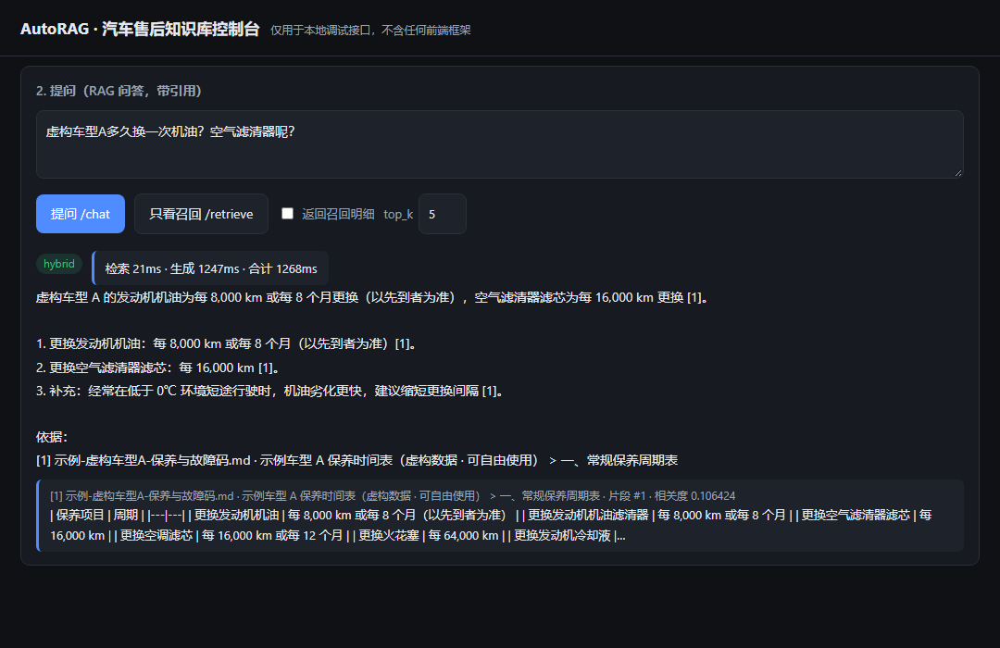
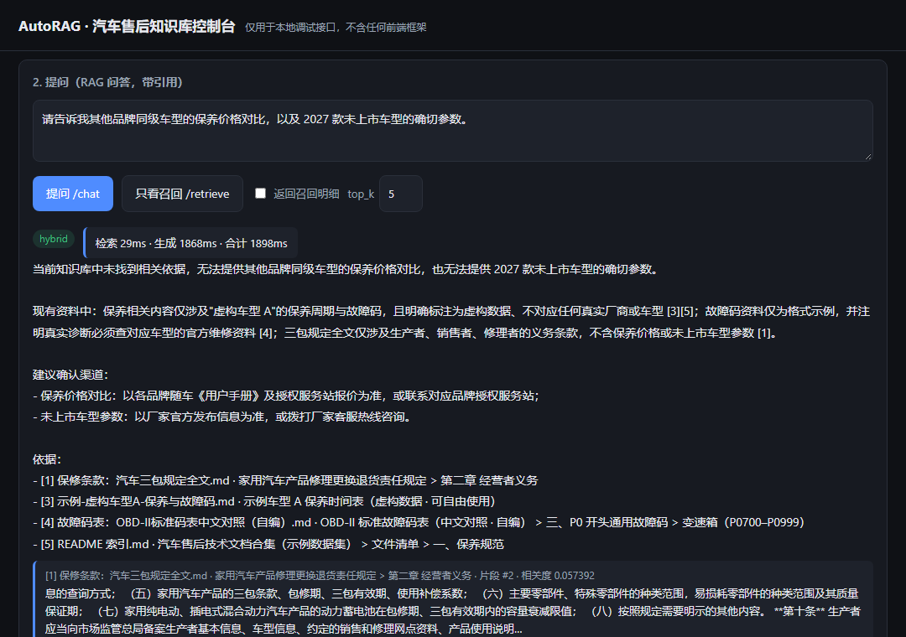

# AutoRAG · 汽车售后 RAG 知识库问答系统

> 一个**可运行、可复现、可讲清**的 RAG 后端：文档切分入库 → 向量 + BM25 混合检索 → 生成**带引用来源**的回答。
> FastAPI · Chroma · 本地 BGE 向量 · 自研 BM25 · Docker

**它和"直接问大模型"的区别**：每个结论都必须给出处（`[1]` 角标 + 依据列表），
服务端会校验引用编号是否越界；**检索不到依据时不调用大模型**，直接说明"未找到"并给确认渠道，
从源头掐掉无依据生成。

---

## 30 秒看懂这个项目

| 你可能关心 | 这个项目怎么做的 |
| --- | --- |
| 只会调 API，不懂检索？ | 向量召回 + **自研 BM25**（零依赖，中英文混合分词）→ **RRF 融合** → **多信号重排**，每一环都能单独观测 |
| 模型瞎编参数怎么办？ | 提示词硬约束 + **服务端引用越界校验** + 无依据时**不调用模型**，三层兜底 |
| 表格、故障码这类结构化内容会被切坏？ | Markdown 表格作为**原子块**处理，超长表按行切并**逐片重复表头** |
| 怎么知道是不是真能跑？ | 242 + 93 项纯逻辑断言 + 启动自检脚本 + 评测脚本，全部可一条命令复现 |
| 遇到问题怎么定位？ | `/retrieve` 只做检索不花 token；响应里带 `latency` 拆解与 `warnings` |

**效果示例**（以下为真实运行截图，基于仓库内 `data/documents/` 的示例数据集）

**① 正常问答**：结论 + `[n]` 角标 + 依据列表 + 命中的原文片段，右上角还有检索/生成耗时拆解



**② 无依据时拒答**：明确说"未找到"，指出资料里有什么、没有什么，并给出确认渠道



**③ 配套文档站**：同一套内容还拆成了 21 页的 MkDocs 站点，放在 `wiki/` 下。左侧导航 + 中文分词搜索，
图表和字体全部本地化（断网可用），严格模式构建零警告。

```bash
cd wiki
mkdocs serve      # http://127.0.0.1:8001 本地预览
mkdocs build      # 生成静态站点到 wiki/site
```

> 截图里的界面就是项目内置的控制台（`http://127.0.0.1:8000/`），不是示意图。
> 控制台支持 `?q=问题&autorun=1&shot=1` 参数自动提问并进入截图模式，例如
> `http://127.0.0.1:8000/?shot=1&autorun=1&q=虚构车型A多久换一次机油` —— 你也可以一键复现这两张图。

<details>
<summary>展开查看第 ① 张图的文字版（便于检索与复制）</summary>

```text
问：虚构车型A多久换一次机油？空气滤清器呢？

答：虚构车型 A 的发动机机油为每 8,000 km 或每 8 个月更换（以先到者为准），
    空气滤清器滤芯为每 16,000 km 更换 [1]。

    1. 更换发动机机油：每 8,000 km 或每 8 个月（以先到者为准）[1]。
    2. 更换空气滤清器滤芯：每 16,000 km [1]。
    3. 补充：经常在低于 0℃ 环境短途行驶时，机油劣化更快，建议缩短更换间隔 [1]。

    依据：
    [1] 示例-虚构车型A-保养与故障码.md · 示例车型 A 保养时间表（虚构数据 · 可自由使用） > 一、常规保养周期表
```

</details>

<details>
<summary>展开查看第 ② 张图的文字版</summary>

```text
问：请告诉我其他品牌同级车型的保养价格对比，以及 2027 款未上市车型的确切参数。

答：当前知识库中未找到相关依据，无法提供其他品牌同级车型的保养价格对比，
    也无法提供 2027 款未上市车型的确切参数。
    现有资料中：保养相关内容仅涉及"虚构车型 A"的保养周期与故障码，且明确标注为虚构数据；
    故障码资料仅为格式示例，并注明真实诊断必须查对应车型的官方维修资料；
    三包规定全文仅涉及生产者、销售者、修理者的义务条款，不含保养价格或未上市车型参数。

    建议确认渠道：
    - 保养价格对比：以各品牌随车《用户手册》及授权服务站报价为准；
    - 未上市车型参数：以厂家官方发布信息为准。

    （响应里 refused 字段与 warnings 会标明本次是否走了兜底 / 是否存在越界引用）
```

</details>

---

## 快速开始（不填任何 Key 也能先验证检索链路）

```bash
# 1) 安装依赖（Python 3.10+；Chromadb 版本说明见第 3 节）
python -m venv .venv
.venv\Scripts\Activate.ps1          # Linux/macOS: source .venv/bin/activate
pip install -r requirements.txt

# 2) 准备配置并自检（默认 EMBEDDING_PROVIDER=hash，无需任何 Key）
copy .env.example .env               # Linux/macOS: cp .env.example .env
python scripts/preflight.py          # 期望：阻塞项 0 / 问题项 0
python tests/smoke_test.py           # 期望：通过 75 项 / 失败 0 项

# 3) 启动并入库示例知识库
uvicorn app.main:app --reload --port 8000
#   → 内置调试控制台： http://127.0.0.1:8000/
#   → 接口文档：       http://127.0.0.1:8000/docs
python scripts/ingest.py --rebuild
```

到这里**检索链路**（加载 → 切分 → 向量化 → 入库 → 混合检索）就验证完了，零 token 消耗。
要让它在检索结果基础上**生成答案**，只需在 `.env` 填 `LLM_API_KEY`（任何 OpenAI 兼容服务），
再按第 [3.3 节](#33-第二步填-key切换成真正的语义检索) 切换向量模型即可。

```bash
# 只测召回、不花 token
python scripts/run_eval.py --mode retrieve --limit 5
# 完整问答评测（消耗 token）
python scripts/run_eval.py --limit 5
```

---

> **关于效果与验证状态的说明（请先读）**
> 本项目的**代码、依赖安装、服务启动、入库、检索、问答、流式、评测**均已在
> Windows + Python 3.13.9 上实际执行验证，结果记录在 [12. 实测记录](#12-实测记录诚实版只记录真实执行过的内容)。
> 但请注意：这些是**单机、单次、小样本**的真实执行结果，**不是准确率、召回率、QPS 或性能基准**，
> 也没有与任何其他系统做对比。所有需要你补齐的密钥、路径、知识库内容与评测答案，
> 统一用 `[待补充]` 标注。你自己跑出来的数字才是你的环境下的真实结果。
>
> 已知的检索失败样例也如实记录在
> [12.2 节](#122-第三轮换成可公开的示例数据集后的复测含未解决的失败样例)（9 条查询：第 1 名命中 7/9、前 3 名 8/9），
> 并说明了为什么继续调权重没有意义。

> **用途与数据来源声明**
> 本项目用于**技术学习与求职作品集展示**，不公开部署在线服务。
> 仓库内示例文档为**虚构数据**（`data/documents/示例-虚构车型A-保养与故障码.md`）
> 或**不受著作权保护的法律法规全文**。项目不代表任何汽车厂商官方口径，
> 不构成维修或保养建议。若你要放入自己的真实文档：本地学习研究属合理使用，
> 但**公开提供检索属于信息网络传播行为**，需自行确认授权范围。
> 发布前请先跑 `python scripts/publish_check.py`，详见 [portfolio.md](portfolio.md)。

> **许可协议**
> 代码采用 [MIT License](LICENSE)，可自由使用、修改、分发。
> `data/documents/` 下的示例文档授权情况单独说明在 [NOTICE](NOTICE)：
> 虚构示例文档与自编码表对照表由作者构造（按 MIT）；
> 法规全文来自政府公开渠道，依《著作权法》第五条不受著作权保护。

---

## 1. 这个项目有什么（面试可讲的技术点）

| 能力 | 实现方式 | 对应代码 |
| --- | --- | --- |
| 结构感知切分 | 标题层级 + 段落 + 句子三级兜底；**Markdown 表格作为原子块**、超长表按行切并逐片重复表头 | `app/core/chunker.py` |
| 多格式加载 | `.md/.markdown/.txt` 内置；`.pdf/.docx` 走可选依赖，缺失时给出安装提示而不是崩溃 | `app/core/loader.py` |
| 向量库 | Chroma `PersistentClient` 落盘，cosine 距离，**显式传入自己算的向量**（不依赖 Chroma 默认模型下载） | `app/core/vector_store.py` |
| 混合检索 | 向量召回 + 自研 BM25（零依赖、中英文混合分词含中文 bigram）→ RRF 融合 → 四信号重排（融合分/词覆盖/高精度串/整句命中） | `app/core/bm25.py`、`app/core/retriever.py` |
| 语义精排（可选） | 承接混合检索结果，用 cross-encoder 对 `(query, passage)` 联合编码打分。实测把「车辆失火是什么原因」从第 3 名提到第 1 名；CPU 上 8 候选约 3.7s | `app/core/reranker.py` |
| 逐句归因校验 | 把回答拆成**分句**，逐句核对关键词是否真在被引用的片段里 —— 抓「引用编号合法、但内容并不在片段中」这类编号校验看不出的幻觉 | `app/core/attribution.py` |
| Agent 自检 | 答完后用归因校验自检，发现无依据断言就带反馈回 `agent` 重答一轮（上限可配）。判据确定性，不额外调用 LLM 自评 | `app/agent/graph.py` |
| Embedding 可切换 | `api`（OpenAI 兼容）/ `local`（sentence-transformers）/ `hash`（零依赖，仅验证链路） | `app/core/embedding.py` |
| 带引用回答 | 资料按 `[n]` 编号注入提示词，回答必须带角标；服务端校验角标是否越界 | `app/services/rag_pipeline.py` |
| 无依据兜底 | 检索为空或（纯向量模式下）相似度低于阈值时**不调用大模型**，直接返回确认渠道 | 同上 `should_refuse` |
| 增量入库 | `data/registry.json` 记录 checksum，未变更文件跳过；磁盘删除的文档同步清理 | `app/services/ingestion_service.py` |
| 可观测 | `/health`、`/stats`、每次问答返回 `latency` 拆解（检索/生成/合计）与 token 用量 | `app/api/routes_system.py` |
| 评测闭环 | 20 条评测集（真值已补齐）+ HTTP 接口评测 + 独立脚本，输出 JSON/Markdown 报告 | `eval/eval_set.json`、`scripts/run_eval.py` |
| 交付 | Dockerfile（非 root + healthcheck + tini）、docker-compose.yml、内置零依赖调试控制台 | `Dockerfile`、`app/web/console.html` |

---

## 2. 目录结构

```text
AutoRAG/
├── app/
│   ├── main.py                  # FastAPI 入口：lifespan 装配、路由挂载、GET /api/v1/ask、调试控制台
│   ├── config.py                # .env -> Settings（含占位符检测、路径解析、启动自检）
│   ├── models.py                # Pydantic 数据契约（请求/响应/引用/评测集）
│   ├── logging_conf.py          # 日志统一格式
│   ├── api/
│   │   ├── deps.py              # ServiceContainer 与依赖注入、可选 X-API-Key 校验
│   │   ├── routes_system.py     # /health /stats /sources /version DELETE /collection
│   │   ├── routes_ingest.py     # /ingest /ingest/upload
│   │   ├── routes_qa.py         # /retrieve /chat /chat/stream /chunks/preview
│   │   └── routes_eval.py       # /eval/dataset /eval/run /eval/reports
│   ├── core/
│   │   ├── text_utils.py        # 归一化、分句、中英混合分词、哈希、摘要
│   │   ├── chunker.py           # 三级切分 + 重叠 + 章节路径
│   │   ├── loader.py            # 文档读取（md/txt/pdf/docx）
│   │   ├── embedding.py         # api / local / hash 三种 embedder
│   │   ├── vector_store.py      # Chroma 封装
│   │   ├── bm25.py              # 自研 BM25 + JSON 持久化
│   │   ├── retriever.py         # 向量 + BM25 + RRF 融合 + 重排
│   │   ├── reranker.py          # cross-encoder 语义精排（可选，懒加载 + 失败降级）
│   │   ├── attribution.py       # 逐句归因校验（防幻觉，确定性、零额外模型调用）
│   │   └── llm_client.py        # OpenAI 兼容客户端（同步 + SSE 流式 + 重试）
│   ├── services/
│   │   ├── container.py         # 组件装配（失败降级不崩服务）
│   │   ├── ingestion_service.py # 扫描/增量/删除/BM25 重建
│   │   ├── rag_pipeline.py      # 提示词、引用组装、校验、兜底
│   │   └── eval_service.py      # 评测运行与报告落盘
│   ├── guard/                   # FreshGuard：知识库变更影响分析
│   │   ├── claims.py            # 原子化声明模型（归一化、变更判定、严重度分级）
│   │   ├── extractor.py         # LLM 结构化抽取 + 证据子串校验 + 增量复用
│   │   ├── store.py             # SQLite 声明版本库（doc_version / chunk_hash / claim）
│   │   └── service.py           # 增量抽取编排、跨版本差分、影响面反查
│   ├── agent/                   # LangGraph Agent：自主决定调用哪些工具
│   │   ├── kb.py                # 业务工具数据层（故障码 / 保养周期，SQLite + 表格机械解析）
│   │   ├── tools.py             # 四个工具（search_kb / lookup_dtc / compute_maintenance / ask_user）
│   │   ├── graph.py             # 状态图：agent / tools / finalize 三节点 + 条件路由
│   │   └── service.py           # 服务封装：一次性调用与 SSE 事件流
│   └── web/
│       ├── console.html         # 内置调试页（打开 http://127.0.0.1:8000/ 即用）
│       └── guard.html           # 变更审计面板（打开 http://127.0.0.1:8000/guard）
├── eval/
│   ├── eval_set.json            # 20 条评测集，ground_truth 已按现有语料补齐
│   └── results/                 # 评测报告输出目录（自动创建）
├── scripts/
│   ├── preflight.py             # 启动前自检：一条命令定位环境/配置/依赖问题
│   ├── ingest.py                # 命令行入库（调 HTTP 接口，保证三处状态一致）
│   ├── run_eval.py              # 命令行评测（纯标准库，输出 JSON + Markdown）
│   └── publish_check.py         # 作品集发布前检查（密钥/文档侵权风险/运行时产物）
├── resume/                      # 求职材料（面试问答、演示脚本）—— 已被 .gitignore 排除，勿公开
├── portfolio.md                 # 作品集发布说明（脱敏步骤、仓库结构建议、声明模板）
├── data/
│   ├── documents/               # 你的知识库文档放这里
│   ├── chroma/                  # 向量库持久化（自动生成）
│   ├── uploads/                 # 上传文件落地（自动生成）
│   ├── registry.json            # 增量入库记录（自动生成）
│   └── bm25_index.json          # BM25 索引（自动生成）
├── tests/smoke_test.py          # 冒烟测试（无需大模型，验证切分/BM25/融合逻辑）
├── .env.example                 # 环境变量模板（复制为 .env 后填写）
├── requirements.txt             # 核心依赖
├── requirements-local.txt       # 可选：本地向量模型
├── Dockerfile
├── docker-compose.yml
├── wiki/                        # MkDocs 文档站（21 页 / 7 个分组，可离线查阅）
├── LICENSE                      # MIT
├── NOTICE                       # 示例文档的来源与授权说明
└── README.md
```

---

## 3. 完整安装与配置步骤

> 如果你已经按开头「快速开始」跑通了检索链路，可以直接跳到 [3.3 节](#33-第二步填-key切换成真正的语义检索)
> 配置对话模型；本节其余内容是给第一次接触本项目的人准备的完整说明。

### 3.1 环境要求

- Python **3.10+**（开发时按 3.11 编写；容器镜像用 `python:3.11-slim`）
- 可访问外网（下载依赖、调用 LLM API）
- 不需要本地 GPU

### 3.2 第一步：跑通检索链路（不填任何 Key）

开头的「快速开始」三步已经覆盖了安装、自检与入库。这里补充**验证清单**——
做完这三步，链路（加载 → 切分 → 向量化 → 入库 → 混合检索）就算验证完成：

| 验证项 | 命令 | 期望结果 |
| --- | --- | --- |
| 环境与配置 | `python scripts/preflight.py` | 阻塞项 0、问题项 0 |
| 纯逻辑正确性 | `python tests/smoke_test.py` | 通过 75 项、失败 0 项 |
| 入库 | `python scripts/ingest.py --rebuild` | `indexed=6`、`total_chunks_in_store=87` |
| 召回（零 token） | 见下方 curl | 返回结果里同时带 `vector_score` 与 `keyword_score` |
| 批量召回评测（零 token） | `python scripts/run_eval.py --mode retrieve` | 跑通并生成 JSON + Markdown 报告 |

```bash
# 只看向量召回与 BM25 融合结果，不调用大模型、不消耗 token
curl -X POST http://127.0.0.1:8000/api/v1/retrieve ^
  -H "Content-Type: application/json" ^
  -d "{\"query\":\"虚构车型A多久换一次机油\"}"
```

此时 `/api/v1/health` 会显示 `llm_ready=false`（因为 `LLM_API_KEY` 还是 `[待补充]`），
这是**预期行为**：健康检查会如实报告未配置，而不是假装正常。

> **Python 版本注意事项（实测踩过的坑）**
> `chromadb` 0.5.x 依赖 `chroma-hnswlib`，而它**只发布了到 cp311 的 Windows wheel**，
> 所以在 Python 3.12 / 3.13 上会退化成源码编译，并报
> `Microsoft Visual C++ 14.0 or greater is required`。
> 本项目因此在 `requirements.txt` 里固定 `chromadb>=1.0,<2.0`（提供 cp39-abi3 预编译 wheel，
> Python 3.9+ 直接可装），并已在 Python 3.13.9 上实测通过。
> 如果你必须用 0.5.x，请改用 **Python 3.11** 解释器。

只有"生成答案 + 引用"这一段需要 LLM Key，见下一节。

### 3.3 第二步：填 Key，切换成真正的语义检索

编辑 `.env`：

```dotenv
# 对话模型（示例为 DeepSeek，其它 OpenAI 兼容服务同理）
LLM_API_KEY=[待补充]                 # 换成你的真实 Key
LLM_BASE_URL=https://api.deepseek.com/v1
LLM_MODEL=deepseek-chat

# 向量模型：改掉 provider，并填写三要素 + 维度
EMBEDDING_PROVIDER=api
EMBEDDING_API_KEY=[待补充]
EMBEDDING_BASE_URL=[待补充]          # 形如 https://xxx/v1
EMBEDDING_MODEL=[待补充]             # 形如 text-embedding-3-small / bge-m3
EMBEDDING_DIM=[待补充]               # 与模型输出维度一致，例如 1536 / 1024
```

改完**必须重建向量库**，因为新旧向量不在同一空间：

```bash
python scripts/ingest.py --rebuild
```

### 3.4 第三步：放入你的知识库文档

把文档放进 `data/documents/`（可用子目录，来源标识为相对路径，例如 `保养/周期表.md`），然后：

```bash
python scripts/ingest.py            # 增量入库
python scripts/ingest.py --rebuild  # 全量重建
```

### 3.5 第四步：提问题

```bash
curl -X POST http://127.0.0.1:8000/api/v1/chat ^
  -H "Content-Type: application/json" ^
  -d "{\"question\":\"更换机油后需要复位保养提醒吗？\",\"debug\":true}"
```

（Linux/macOS 把 `^` 换成 `\` 并把内层引号改为单引号。）

---

## 4. 接口一览

所有业务接口前缀 `/api/v1`。若 `.env` 里配置了 `API_KEY`，除 `/health` 外都需要请求头
`X-API-Key: <你的值>`；不配置则不需要鉴权（本地开发默认如此）。

| 方法 | 路径 | 说明 |
| --- | --- | --- |
| GET | `/api/v1/health` | 健康检查。`?probe_llm=true` 会真实调用一次 LLM（max_tokens=1） |
| GET | `/api/v1/stats` | 知识库统计：片段数、已索引文档数、BM25 规模、配置告警 |
| GET | `/api/v1/sources` | 列出向量库中已有的来源文件 |
| GET | `/api/v1/version` | 版本与配置指纹 |
| DELETE | `/api/v1/collection` | 清空向量库与 BM25 索引（不会删除原始文档） |
| POST | `/api/v1/ingest` | 扫描 `data/documents` 增量入库；`{"rebuild":true}` 全量重建 |
| POST | `/api/v1/ingest/upload` | 上传单个文档；`?auto_ingest=true` 时立即入库 |
| POST | `/api/v1/retrieve` | **只检索**，不调用大模型（用于单独评估召回质量） |
| POST | `/api/v1/chat` | 完整问答，返回 `answer` + `citations` + `latency` + `usage`；请求可带 `session_id` 开启多轮（见 12.15） |
| POST | `/api/v1/session/clear` | 清除会话历史；`session_id` 留空则清空全部（多轮评测可重复的前提） |
| POST | `/api/v1/cache/clear` | 清空查询缓存（运维/测试用；正常由索引版本机制自动失效） |
| POST | `/api/v1/ingest` | 增量入库；`async_mode=true` 立即返回 job_id（见 12.19），同一时刻仅允许一个任务，冲突 409 |
| GET | `/api/v1/ingest/status/{job_id}` | 入库任务进度与结果；`GET /ingest/jobs` 列出最近任务 |
| GET | `/api/v1/cache/stats` | 缓存统计：条目数 / 命中 / 未命中 |
| GET | `/api/v1/metrics` | 请求指标：延迟 P50/P95/P99（总体+分端点）/ token 消耗 / 成本估算 / 缓存命中率 |
| POST | `/api/v1/chat/stream` | SSE 流式问答：先 `meta` 事件（含引用），再 `token`，最后 `done` |
| GET | `/api/v1/ask` | GET 版问答，便于浏览器或 curl 直接试 |
| GET | `/api/v1/chunks/preview` | 预览向量库中的少量片段（人工抽查切分质量） |
| GET | `/api/v1/eval/dataset` | 查看评测集概况与待补充字段 |
| POST | `/api/v1/eval/run` | 运行评测集（**会消耗 token**），报告落盘到 `eval/results/` |
| GET | `/api/v1/eval/reports` | 列出历史评测报告 |
| POST | `/api/v1/agent/chat` | **Agent 问答**（LangGraph 自主调用工具），返回 `answer` + `citations` + `tool_trace` |
| POST | `/api/v1/agent/chat/stream` | Agent 问答 SSE 流式：推送节点决策与每个工具的入参出参 |
| GET | `/api/v1/agent/tools` | 列出四个工具及完整 JSON schema |
| GET | `/api/v1/agent/status` | Agent 状态：可用工具、迭代上限、业务库规模 |
| POST | `/api/v1/agent/kb/rebuild` | 从 `data/documents` 重建业务工具知识库（故障码 / 保养周期） |
| GET | `/api/v1/guard/panel` | FreshGuard 变更审计面板（HTML，也可用 `http://127.0.0.1:8000/guard`） |
| POST | `/api/v1/guard/extract?source=…` | 对单个文档做增量抽取（`force=true` 则全量重抽） |
| POST | `/api/v1/guard/scan` | 扫描知识库并对所有文档增量抽取（**首次会消耗较多 token**） |
| GET | `/api/v1/guard/versions` | 各文档的最新版本与声明数 |
| GET | `/api/v1/guard/diff?source=…` | 某文档最近两个版本的失效清单（按严重度排序） |
| GET | `/api/v1/guard/diff/all` | 汇总所有文档的高严重度变更 |
| GET | `/api/v1/guard/affects?keyword=…` | 影响面反查：某事实在库内被哪些文档引用 |
| GET | `/api/v1/guard/claims?keyword=…` | 浏览当前库中的声明 |
| GET | `/api/v1/guard/stats` | 声明库统计与抽取器运行统计 |

### 4.1 `/api/v1/chat` 请求/响应示例

请求：

```json
{
  "question": "首保应该在多少公里或多长时间内进行？",
  "top_k": 5,
  "retrieval_mode": "hybrid",
  "debug": true
}
```

响应（字段结构如下；具体内容取决于你的知识库与模型）：

```json
{
  "question": "首保应该在多少公里或多长时间内进行？",
  "answer": "……（模型输出，每处结论带 [1] 这类角标）……\n\n依据：\n[1] 保养周期.md · 保养 > 首保",
  "citations": [
    {
      "index": 1,
      "chunk_id": "doc_xxxxxxxxxx::3",
      "source": "保养周期.md",
      "title": "保养周期",
      "section": "保养 > 首保",
      "position": 3,
      "score": 0.0,
      "snippet": "……"
    }
  ],
  "retrieved": [],
  "refused": false,
  "retrieval_mode": "hybrid",
  "model": "deepseek-chat",
  "latency": { "retrieve_ms": 0, "generate_ms": 0, "total_ms": 0 },
  "usage": { "prompt_tokens": 0, "completion_tokens": 0, "total_tokens": 0 },
  "warnings": []
}
```

`warnings` 值得关注，它会在这些情况下出现（服务端如实报告，不掩盖）：

- 模型给出的 `[n]` 超出了实际资料编号范围 → `引用编号越界`；
- 模型一个角标都没打 → 提示可能未遵循引用格式，`citations` 会退化为全部召回来源；
- 检索为空但 `REFUSE_WHEN_EMPTY=false` → 提示回答可能无依据；
- `EMBEDDING_PROVIDER=hash` → 提示当前不具备真正的语义检索能力。

### 4.2 流式调用示例（Python）

```python
import json
import httpx

with httpx.stream(
    "POST",
    "http://127.0.0.1:8000/api/v1/chat/stream",
    json={"question": "刹车片磨损到多少毫米需要更换？"},
    timeout=120.0,
) as response:
    for line in response.iter_lines():
        if not line:
            continue
        if line.startswith("event:"):
            event = line.split(":", 1)[1].strip()
        elif line.startswith("data:"):
            payload = json.loads(line.split(":", 1)[1].strip())
            if event == "meta":
                print("引用来源：", [c["source"] for c in payload["citations"]])
            elif event == "token":
                print(payload["text"], end="", flush=True)
            elif event == "done":
                print("\n", payload)
```

> 流式模式**不做**服务端引用越界校验（回答还在生成中），前端拼接完成后如需校验请改用
> `POST /api/v1/chat`。这一点在 `done` 事件里也会明确提示。

---

## 5. 环境变量清单

复制 `.env.example` → `.env` 后按需修改。`[待补充]` 表示必须由你填写的项。

| 变量 | 默认值 | 是否必填 | 说明 |
| --- | --- | --- | --- |
| `LLM_API_KEY` | `[待补充]` | **是**（问答功能） | 对话模型密钥 |
| `LLM_BASE_URL` | `https://api.deepseek.com/v1` | 是 | OpenAI 兼容地址，需含 `/v1` |
| `LLM_MODEL` | `deepseek-chat` | 是 | 模型名 |
| `LLM_TIMEOUT_SECONDS` | `60` | 否 | 单次请求超时 |
| `LLM_MAX_RETRIES` | `3` | 否 | 失败重试次数（429/5xx/网络错误才重试） |
| `LLM_TEMPERATURE` | `0` | 否 | LLM 采样温度；12.26 实测 0 比 0.1 的 faithfulness 极差收窄 7 倍 |
| `LLM_MAX_TOKENS` | `1024` | 否 | 单次生成上限 |
| `EMBEDDING_PROVIDER` | `hash` | 是 | `api` / `local` / `hash`，正式使用请选 `api` |
| `EMBEDDING_API_KEY` | `[待补充]` | provider=api 时必填 | 向量模型密钥 |
| `EMBEDDING_BASE_URL` | `[待补充]` | provider=api 时必填 | 向量接口地址（含 `/v1`） |
| `EMBEDDING_MODEL` | `[待补充]` | provider=api 时必填 | 向量模型名 |
| `EMBEDDING_DIM` | `[待补充]` | provider=api 时必填 | 向量维度，须与模型一致 |
| `LOCAL_EMBEDDING_MODEL` | `[待补充]` | provider=local 时必填 | 本地模型名或本地目录路径 |
| `LOCAL_EMBEDDING_DIM` | `[待补充]` | 否 | 留空则由模型自动推断 |
| `HASH_EMBEDDING_DIM` | `1024` | 否 | hash 模式向量维度 |
| `DOCUMENTS_DIR` | `./data/documents` | 否 | 知识库目录（相对项目根目录解析） |
| `CHROMA_DIR` | `./data/chroma` | 否 | 向量库落盘目录 |
| `UPLOAD_DIR` | `./data/uploads` | 否 | 上传文件目录 |
| `REGISTRY_PATH` | `./data/registry.json` | 否 | 增量索引记录 |
| `BM25_INDEX_PATH` | `./data/bm25_index.json` | 否 | BM25 索引落盘位置 |
| `CHROMA_COLLECTION` | `auto_after_sales` | 否 | 集合名 |
| `CHUNK_SIZE` | `600` | 否 | 目标片段字符数 |
| `CHUNK_OVERLAP` | `80` | 否 | 相邻片段重叠字符数（代码内保证 < CHUNK_SIZE） |
| `CHUNK_MIN_CHARS` | `80` | 否 | 小于该长度的碎块并入前一块 |
| `RETRIEVAL_MODE` | `hybrid` | 否 | `vector` / `keyword` / `hybrid` |
| `RRF_K` | `60` | 否 | RRF 融合常数 |
| `VECTOR_WEIGHT` | `1.0` | 否 | 融合中向量通道权重 |
| `KEYWORD_WEIGHT` | `0.8` | 否 | 融合中 BM25 通道权重 |
| `TOP_K` | `5` | 否 | 最终喂给模型的片段数 |
| `CANDIDATE_K` | `20` | 否 | 每路召回候选数 |
| `MIN_SCORE` | `0.05` | 否 | 仅 `RETRIEVAL_MODE=vector` 时生效的拒答阈值 |
| `REFUSE_WHEN_EMPTY` | `true` | 否 | 检索为空时是否跳过 LLM 直接兜底 |
| `SESSION_MAX_TURNS` | `6` | 否 | 每个会话最多保留的问答轮数（多轮会话，见 12.15） |
| `SESSION_MAX_SESSIONS` | `512` | 否 | 最多同时保留多少个会话，超出淘汰最早的（防内存慢泄漏） |
| `QUERY_CACHE_ENABLED` | `true` | 否 | 查询缓存开关（同样的问题直接返回上次回答，见 12.18） |
| `QUERY_CACHE_TTL_SECONDS` | `3600` | 否 | 缓存条目存活时间（秒）；索引变更会立即失效，TTL 只是兜底 |
| `QUERY_CACHE_MAX_ENTRIES` | `256` | 否 | 缓存最大条目数（LRU 淘汰） |
| `LLM_PRICE_PROMPT_PER_M` | （不配） | 否 | 每百万 prompt token 单价（元）；与下行都配置后 `/metrics` 才输出成本估算 |
| `LLM_PRICE_COMPLETION_PER_M` | （不配） | 否 | 每百万 completion token 单价（元） |
| `QUERY_REWRITE_ENABLED` | `true` | 否 | 有历史时是否用 LLM 把追问改写成独立问题再检索 |
| `REFUSAL_EVIDENCE_FLOOR` | `0.01` | 否 | 最高召回分低于此值即拒答（hybrid 也生效）；`0` 关闭 |
| `REFUSAL_UNSUPPORTED_RATIO` | `0.5` | 否 | 无依据句占比达到此值（且 ≥2 句）判定编造并拒答；`0` 关闭 |
| `RERANK_ENABLED` | `false` | 否 | 是否启用 cross-encoder 语义精排（需先下载模型） |
| `RERANK_MODEL` | `BAAI/bge-reranker-base` | 否 | 精排模型名或本地目录。**中文场景建议 `bge-reranker-v2-m3`**，base 版区分度不足 |
| `RERANK_TOP_N` | `20` | 否 | 只对前 N 个候选做精排；不应小于 `TOP_K`（会被自动纠正） |
| `RERANK_DEVICE` | `cpu` | 否 | `cpu` / `cuda` |
| `RERANK_MAX_LENGTH` | `512` | 否 | 精排时截断长度，直接影响 CPU 耗时（192/256/384/512 实测约 2.8/3.3/5.0/6.8s per 20 条） |
| `RERANK_BATCH_SIZE` | `16` | 否 | 精排批大小 |
| `ATTRIBUTION_ENABLED` | `true` | 否 | 是否做逐句归因校验（防幻觉） |
| `ATTRIBUTION_WEAK_THRESHOLD` | `0.35` | 否 | 覆盖率 ≥ 此值判为"有依据" |
| `ATTRIBUTION_UNSUPPORTED_THRESHOLD` | `0.12` | 否 | 覆盖率低于此值判为"疑似无依据" |
| `AGENT_REFLECTION_ENABLED` | `true` | 否 | Agent 答完后是否自检 |
| `AGENT_MAX_REFLECTIONS` | `1` | 否 | 最多重答轮数（调大会成倍增加延迟与 token） |
| `API_HOST` / `API_PORT` | `0.0.0.0` / `8000` | 否 | 监听地址与端口 |
| `API_KEY` | 空 | 否 | 填了才启用 `X-API-Key` 校验 |
| `CORS_ORIGINS` | `*` | 否 | 允许的跨域来源，逗号分隔 |
| `MAX_UPLOAD_MB` | `20` | 否 | 上传大小上限 |
| `LOG_LEVEL` | `INFO` | 否 | 日志级别 |

---

## 6. 评测集与评测方式

### 6.1 评测集

[eval/eval_set.json](eval/eval_set.json) 提供 **20 条**汽车售后场景问题，`ground_truth` 已按仓库内语料逐条补齐，覆盖：
保养周期、油液规格、易损件、故障码、电气/蓄电池、轮胎胎压、季节性检查、
使用与应急、故障诊断、保修条款与索赔流程，以及 **8 条负样本**（`must_refuse=true`，用于检验系统是否拒答）。

> 修正：此前本文写作「1 条负样本」，与数据不符。实际 **8 条**
> （Q003/Q006/Q008/Q011/Q012/Q014/Q017/Q020），占评测集 40%。
> 这个错误直接导致了下面 6.4 节记录的那个度量漏洞：
> 负样本 `expected_sources` 为空，而旧版计分条件要求「有来源或有关键词」，
> 于是它们长期**完全不参与任何指标统计**。
>
> Q011/Q012 是 2026-10-25 补的（见 12.9）：它们原本标成可答样本，
> 但核心提问在语料里根本没有依据，属于标注错误而非检索失败。

每条字段含义：

| 字段 | 说明 |
| --- | --- |
| `id` | 唯一编号 |
| `category` | 分类，便于按维度看结果 |
| `question` | 用户问题 |
| `ground_truth` | 标准答案（`[待补充]` 表示尚未补全）；参与 `answer_token_f1` 的词面重合计算，**不是准确率** |
| `expected_sources` | 期望命中的来源文件（`data/documents` 下的相对路径），用于来源命中与排序指标 |
| `expected_keywords` | 答案中必须出现的字面串（数值、部件名、故障码），用于关键词覆盖率与「是否有实质内容」判定 |
| `expected_snippets` | **关键原文短语**，用于片段级相关性判定：相关 = 来源命中 **且** 片段正文含该短语。留空则退回文件级（只看来源文件） |
| `must_refuse` | `true` 表示知识库无依据，期望系统拒答 |
| `notes` | 该条想考察什么，便于面试时讲设计意图 |

填齐全 20 条的 `ground_truth` 需要你有真实资料，这一步**必须由你完成**，我不会替你编造。

### 6.2 怎么跑评测

方式一：命令行脚本（推荐，纯标准库，同时产出 Markdown 报告便于人工复核）

```bash
# 完整问答评测（消耗 token）
python scripts/run_eval.py

# 只测召回，不调用大模型，零 token 消耗
python scripts/run_eval.py --mode retrieve

# 只跑前 5 条做快速验证
python scripts/run_eval.py --limit 5
```

方式二：HTTP 接口

```bash
curl -X POST http://127.0.0.1:8000/api/v1/eval/run ^
  -H "Content-Type: application/json" ^
  -d "{}"
```

产出：

- `eval/results/local_report_<时间戳>.json`：逐条问题、召回来源、引用编号、耗时、token 用量；
- `eval/results/local_report_<时间戳>.md`：汇总表 + 逐条回答原文，适合贴进面试材料。

### 6.3 报告里的数字是什么，不是什么

**三类指标的分母不同，不能互相比较**（这一点比指标本身更重要）：

| 指标 | 计算方式 | 分母 | 请注意 |
| --- | --- | --- | --- |
| `source_hit_rate` | 期望来源是否进 top_k | 有 `expected_sources` 的条目（14） | 衡量**文件级召回**，不反映片段级是否找对 |
| `recall_at_k` | 前 k 条覆盖了多少期望来源 | 同上 | 期望多个来源时能反映覆盖不全 |
| `mrr` | 首个相关结果排名的倒数 | 同上 | 只看第一个命中的位置 |
| `ndcg_at_k` | 二值 nDCG，理想排序**仅在召回集内**计算 | 同上 | 衡量排序质量；漏召由 recall 反映 |
| `precision_at_k` | 前 k 条里相关结果占比 | 同上 | 每题只有 1–2 个期望文件时天然偏低 |
| `avg_keyword_coverage` | 期望关键词在回答里的覆盖率 | 有 `expected_keywords` 的条目 | 字面覆盖，同义改写判为未覆盖 |
| `faithfulness` | 逐句归因得分（复用 `attribution` 模块） | 有可校验断言的条目（实测 15~16/20） | 词面覆盖判定，对同义改写偏保守；**分母不含纯拒答**，也把「忘了标引用」算进扣分 |
| `unsupported_ratio` | 无依据分句占比 | 全部被校验分句 | **这才是「归因不足」分型用的信号**（阈值 0.4，且至少 3 句） |
| `no_citation_ratio` | 未标引用分句占比 | 同上 | 格式问题，不参与分型；实测 ~5%（其中约一半是模型真漏标） |
| `refusal_success` | 负样本是否正确拒答 | `must_refuse=true`（8） | 区分 hard / soft / partial 三条路径；**负样本声明缺口即算合格**（含部分披露） |
| `over_refusal_rate` | 可答条目是否被误拒 | `must_refuse=false`（12） | 只统计「没有实质内容」的拒答，部分披露不算 |
| `failure_distribution` | 失败分型分布 | 全部条目 | 一条只给一个主标签，可加总 |
| `citation_out_of_range_items` | 回答里出现越界 `[n]` 的条目 | 全部 | 用于发现幻觉引用 |

**这些都不是准确率**，也没有与任何基线系统对比。要做人工评测，请按
[`ground_truth`](eval/eval_set.json) 逐条人工核对，并把结论记为"人工评测结果（N 条，评测人：你）"。

两个容易踩的坑，已在 `app/core/metrics.py` 里用注释固定下来：

1. **关键词匹配必须先去千分位**。评测集写 `16,000`，模型常写 `16000`，
   旧实现按字面子串匹配会把这种情况判成「没答到」。
2. **token F1 不能当判定依据**。回答里附加了「建议确认渠道」这类必要说明后，
   F1 会被显著稀释（实测某条关键词覆盖 1.0 而 F1 仅 0.16）。所以 F1 只进报告供人工复核，不参与分型。

### 6.4 一处已修复的度量漏洞（记录在此，避免重复踩）

旧版计分条件写的是「有 `expected_sources` **或** `expected_keywords` 才计分」，
而 6 条负样本这两个字段都是空的 —— 它们既不在来源命中率里，也不在关键词覆盖率里，
`must_refuse_satisfied` 只写在逐条明细里、从未汇总。

后果：**30% 的评测数据是死数据**，且拒答能力完全没有被度量。
如果只看出问题前的报告，会以为「拒答成功率」这个指标存在，实际上它从没被计算过。

现在负样本单独成组（`groups.refusal`），拒答指标有独立分母，
并且失败分型里 `must_refuse` 的条目一定会落到 `ok` / `missed_refusal` / `not_evaluated` 三者之一。

---

## 7. Docker 运行

```bash
# 1) 准备 .env（同 3.3 节）
copy .env.example .env

# 2) 构建并启动
docker compose up --build

# 3) 验证
curl http://127.0.0.1:8000/api/v1/health
```

要点：

- `data/` 与 `eval/` 挂载到宿主机，向量库与报告不会随容器销毁丢失；
- `docker-compose.yml` 里把路径统一覆盖为容器内 `/app/data/*`；
- 容器以非 root 用户（uid 10001）运行，入口用 `tini` 转发信号；
- 镜像内置 `HEALTHCHECK`，探测 `/api/v1/health`（**不**探测 LLM，避免额外 token 消耗）；
- 使用 `EMBEDDING_PROVIDER=local` 时体积会显著变大，需要打开 Dockerfile 里被注释的
  `build-essential`，或干脆改用 `api` 模式。

只跑单容器：

```bash
docker build -t autorag:0.1.0 .
docker run --rm -p 8000:8000 --env-file .env -v "%cd%/data:/app/data" autorag:0.1.0
```

---

## 8. 可选依赖

```bash
pip install pypdf              # 解析 PDF
pip install python-docx        # 解析 DOCX
pip install -r requirements-local.txt   # 本地向量模型（会拉取 torch，体积较大）
```

未安装对应依赖时，上传/入库该类文件会返回**明确的错误信息+安装命令**，不会静默跳过。

### 8.1 本地向量模型（`EMBEDDING_PROVIDER=local`）的实战注意事项

这条路走通了，但踩过三个坑，都已写进代码：

```dotenv
EMBEDDING_PROVIDER=local
LOCAL_EMBEDDING_MODEL=BAAI/bge-small-zh-v1.5
LOCAL_EMBEDDING_DIM=512          # 实测该模型输出 512 维
HF_ENDPOINT=https://hf-mirror.com # 国内镜像；留空时代码会自动探测并兜底
HF_HUB_OFFLINE=1                 # 权重下载完成后置 1，改为纯本地加载
```

| 坑 | 现象 | 代码里的处理 |
| --- | --- | --- |
| hosts 把 huggingface.co 指向 127.0.0.1 | 报 `CERTIFICATE_VERIFY_FAILED`，看起来像网络不通 | `_huggingface_host_is_blackholed()` 检测到就自动切镜像并打日志 |
| `HF_ENDPOINT` 写进 `.env` 却不生效 | 配了镜像仍走 huggingface.co | `.env` 的值不会自动进 `os.environ`，且 huggingface_hub 在 import 时把端点固化进常量；现在会同时写环境变量 + 覆盖 `huggingface_hub.constants.ENDPOINT` |
| 部分库（实测 transformers 探测 adapter_config.json）绕过镜像 | 每次加载重试十几秒并刷一屏 SSL 报错 | `HF_HUB_OFFLINE=1` 时用 `local_files_only=True` 纯本地加载 |

另外：`bge` 系列官方要求**查询侧加指令前缀**（`为这个句子生成表示以用于检索相关文章：`），
代码会按模型名自动加，文档侧不加。实测在 3 条文本的样本上前缀让"正确答案/干扰项"的相似度比值
从 1.45 提升到 1.55（排序未变，样本太小不足以作为效果证据）；如需关闭：
`BGE_QUERY_INSTRUCTION=none`。

首次下载大约需要 100 秒左右（取决于网速），之后本地 CPU 编码一般每批百毫秒级；
具体耗时请以你自己机器实测为准。

---

## 9. 排查手册（报错时先看这里）

### 9.0 先跑一次自检（最省时间的一步）

```bash
python scripts/preflight.py            # 不调用 LLM，零 token 消耗
python scripts/preflight.py --ping-llm # 额外真实探测一次 LLM，约 1 token
```

它会一次性检查：Python 与依赖版本（含 FastAPI 是否 ≥ 0.115）、`.env` 是否存在以及哪些项还是
`[待补充]`、21 个模块能否导入、切分 / BM25 / hash 向量 / 引用校验是否正常、embedding 接口的
**真实维度**与 `EMBEDDING_DIM` 是否一致、Chroma 能否打开以及**库里存的向量维度与当前配置是否一致**
（专门用来发现"换了 embedding 却没重建"）、LLM 是否配置与能否连通、知识库目录有没有文档、
评测集 JSON 是否合法。

输出同时打印到屏幕并写入 `data/preflight_report.txt`，内容**不含任何密钥**，可以直接整段贴出来求助。

### 9.1 常见报错对照表

| 现象 | 原因 | 处理 |
| --- | --- | --- |
| 启动即报 `Embedding 初始化失败：EMBEDDING_PROVIDER=api，但以下配置仍为占位符…` | `.env` 里还是 `[待补充]` | 填写 Key/地址/模型/维度，或先改回 `EMBEDDING_PROVIDER=hash` |
| `/api/v1/chat` 返回 `[生成失败] LLM_API_KEY 未配置…` | 没填对话模型 Key | 填 `LLM_API_KEY` 后重启 |
| 返回 `LLM 接口 404` | `LLM_BASE_URL` 少了 `/v1`，或模型名写错 | 核对服务商文档里的 base_url 与模型名 |
| 返回 `LLM 鉴权失败(401)` | Key 错误或额度用尽 | 换 Key / 充值 |
| `向量维度(...)与 embedder 声明维度(...)不一致` | 换了 embedding 模型但没重建 | `python scripts/ingest.py --rebuild` |
| `向量数量与片段数量不一致` / 入库部分失败 | 向量接口限流或网络抖动 | 看日志与 `/api/v1/ingest` 返回里的 `error`，调小批量或重试 |
| 入库后 `/stats` 的 `collection_count` 为 0 | 文档没放进 `DOCUMENTS_DIR`，或后缀不在白名单 | 看 `/stats` 的 `documents_on_disk` 与 `config_warnings` |
| 回答老是兜底"未找到依据" | 知识库确实没有该内容；或 `MIN_SCORE` 过高；或 `TOP_K` 太小 | 先 `POST /api/v1/retrieve` 看召回，再调参 |
| 回答里的引用编号是 `[7]` 但只有 5 条来源 | 模型编造引用 | 响应的 `warnings` 会明确指出；可降低 `LLM_TEMPERATURE` 或换更强的模型 |
| PDF 入库报 `解析 PDF 需要可选依赖` | 没装 pypdf | `pip install pypdf` |
| 第一次请求特别慢 | 本地向量模型首次下载权重 / Chroma 首次建索引 | 属正常现象，第二次会快；具体耗时请以你自己实测为准 |
| 端口被占用 | 8000 已被占用 | `uvicorn app.main:app --port 8001`，同步改 `.env` 的 `API_PORT` |
| 注册路由时报 `TypeError: Body() got an unexpected keyword argument 'default_factory'` | 本机 FastAPI 版本低于 0.115 | `pip install -U "fastapi>=0.115"`（requirements.txt 已声明该下限） |
| `POST /api/v1/ingest/upload?auto_ingest=true` 后原知识库文档消失 | 旧版本会把上传文件的 source 记成裸文件名，与 `data/documents` 同名文件相撞 | 当前代码已用 `uploads/xxx.md` 作为 source 避免撞名；若你改过这段逻辑，请确认 `load_document(target, target_dir.parent)` 的 root 参数 |
| BM25 对"完全不相关的中文问题"也返回结果 | 中文按单字 + bigram 切分时，任意两句中文都可能共享"的/是/关"这类单字 | 已加相对分数下限 `MIN_RELATIVE_SCORE`（默认 0.15，代码在 `app/core/bm25.py`）。这是分词策略的固有特性，不是 bug；想进一步降低噪声可接 rerank 模型 |
| 我在 `.env` 里配了 `CHUNK_SIZE=80`，实际却按 120 切 | 切分器里曾有一层硬编码下限，会静默覆盖用户配置 | 已移除切分器内的下限，统一由 `Settings.normalize()` 处理（低于 120 会纠正并在 `/health` 的 `config_warnings` 里提示） |
| 调用 `/api/v1/chat/stream` 后服务端日志出现 `async generator ignored GeneratorExit` | 客户端提前断开且 SSE 生成器在 `finally` 里 `yield` | 当前代码已把 `done` 事件移出 `finally`；若你自行改造过该生成器，请勿在 `finally` 中 `yield` |

服务端日志会打印完整堆栈，遇到问题时把**日志最后 30 行 + 接口原始响应**一起发出来即可定位。

---

## 10. 设计与安全说明（以及已知局限）

### 做得比较克制的地方

- **不编造数据**：仓库内所有数值均为 `[待补充]` 占位，示例文档也明确标注不是真实数据；
- **不隐藏降级**：`hash` 模式、LLM 未配置、引用越界都会通过 `/health`、响应 `warnings` 明确暴露；
- **密钥管理**：只从 `.env` / 环境变量读取，日志与接口响应从不回显密钥明文
  （`/health` 与 `/stats` 只返回"是否已配置"）；
- **提示词约束**：明确要求只依据资料作答、保留版本限定、无依据时拒答并给确认渠道；
- **服务端校验**：对模型输出的 `[n]` 做越界检测，避免"看起来有引用其实没有"。

### 已知局限（面试时能主动说出来，比被问出来更好）

1. **单进程内存态 BM25**：索引在进程内存里，多副本部署时各副本的 BM25 会不同步，
   要横向扩容需换成 Elasticsearch/OpenSearch 等外部检索服务；
2. **无重排序模型**：融合后的重排是关键词覆盖率启发式，不是 cross-encoder 精排；
   接一个 rerank 模型是明确的下一步；
3. **无多轮对话**：`session_id` 字段已预留但未实现上下文管理，当前是单轮问答；
4. **无权限与多租户**：所有文档在同一集合里，没有按门店/车型做数据隔离；
5. **引用校验是规则级**：只校验编号是否越界，不做"这句话是否真被该片段支持"的语义一致性校验；
   要更严格需要接 NLI/一致性校验或 LLM-as-judge（并明确标注评测口径）；
6. **入库是同步长任务**：大目录入库会长时间占用请求，生产上应改为后台任务队列
   （如 Celery/RQ/arq）并暴露进度查询；
7. **Chroma 单机持久化**：适合 Demo 与中小规模，超大规模需要评估专用向量数据库。

### 关于 API Key 与合规

- 不要提交 `.env`（`.gitignore` 已忽略）；
- 演示时建议用**已脱敏**的知识库文档，避免把真实客户信息、工单数据入库；
- 若把本项目暴露到公网，请务必设置 `API_KEY`、限制 `CORS_ORIGINS`，
  并在前面加一层网关做鉴权与限流。

---

## 11. 冒烟测试（可选）

```bash
python tests/smoke_test.py          # 242 项纯逻辑断言，不联网、不需要 Key、不调用大模型
python tests/metrics_test.py        # 90 项指标口径断言（Recall/MRR/nDCG/规范化/分型/片段级判定/拒答极性）
python tests/eval_pipeline_test.py  # 评测链路端到端（用假 QA 引擎，验证分组分母与分型自洽）
python scripts/check_snippets.py    # 校验 expected_snippets 标注（改评测集后必跑）
python scripts/preflight.py         # 环境与配置自检（见 9.0 节）
```

`tests/smoke_test.py` 覆盖：文本归一化 / 分句 / 中英混合分词、切分的"多章节产出多片段 + 可复现 +
内容不丢失 + 表格不被切断"、BM25 的中文召回与词典外查询返回空、RRF 融合的双路标记与排序、
引用越界校验、hash embedder 的维度与可复现性。

`tests/metrics_test.py` 重点打三类容易错的地方：数字写法差异（`16,000` vs `16000` vs 全角）、
nDCG 的理想排序只在召回集内计算（口径错会让 nDCG 虚高）、失败分型的判定优先级
（顺序错会把检索问题误报成拒答问题）。

`tests/eval_pipeline_test.py` 测的不是单条算法，而是**组装后的行为**：
分组分母对不对、拒答 hard / soft / partial 三条路径是否被正确区分。
实测中「拒答成功率 100% 但分型里有 6 条漏拒答」这种自相矛盾，单测抓不到，只有这一层能抓。

`scripts/check_snippets.py` 校验片段级标注：每个关键短语必须既能在文档全文中找到，
也能在切分后的某个片段中找到。标注错一个字、或短语正好跨了切分边界，
都不会报错，只会让 recall 悄悄归零 —— 这个脚本把这类问题在标注阶段拦住。

---

## 12. 实测记录（诚实版：只记录真实执行过的内容）

### 12.0 当前基线（滚动更新，做任何优化都对着这张表比）

**这一节是后来加的**：在此之前的每一轮都只在自己的小节里留数字，想看「现在到底多少」
要拼 12.4 → 12.9 → 12.11 → 12.13 四张表。改动本身没有问题，但**没有单一对照点**，
下一步优化就说不清「改好了还是改坏了」。所以把当前值集中在这里，每轮更新。

配置：**58 条评测集**（15 负 / 43 可答，见 12.24）· 79 个片段 · `hybrid` · `top_k=8` · `deepseek-chat` · `RERANK_MAX_LENGTH=256`（12.22）· `RERANK_QUANTIZE=true`（12.23）
另有 **6 条多轮评测**（3 会话 × 2 轮，见 12.15）：Recall 1.0 / MRR 0.875 / 关键词覆盖 1.0 / 归因 1.0
复现：`uvicorn app.main:app --port 8000` 后跑 `python scripts/run_eval.py --mode chat --top-k 8`

| 类别 | 指标 | 值 | 分母 |
| --- | --- | --- | --- |
| 检索 | 来源命中率 / Recall@8（片段级） | **1.0** | 46 |
| 检索 | MRR | **0.8822** | 46 |
| 检索 | nDCG@8 | **0.9071** | 46 |
| 检索 | Precision@8 | **0.1413** | 46 |
| 生成 | 平均关键词覆盖率 | **1.0** | 43 |
| 生成 | 归因得分（`faithfulness`） | **0.954** | 49 / 58 |
| 生成 | 无依据分句 | **1** / 279（0.4%） | 49/58 条有归因 |
| 生成 | 未标引用分句 | **11** / 275（4%） | 同上 |
| 拒答 | 负样本拒答成功率 | **1.0** | 15 |
| 拒答 | 过度拒答率 | **0.0** | 43 |
| 分型 | 通过 / 排序靠后 | **57 / 1** | 58 |
| 测试 | smoke / agent / metrics / 链路 | **242 / 86 / 93 / 全通过** | — |

**怎么读这张表**（下面这些数字是 `--repeat 3` 实测出来的，不是估的）：

- **检索侧是确定性的**：三轮的 Recall/MRR/nDCG/Precision **逐位相同**（`min=max`），
  可以直接比、不需要区间。
- **生成侧不是**：`faithfulness` 0.884~0.897、被校验分句 103~110、无依据分句 0~1、
  未标引用 3~6。所以这些只能读作区间。
- **但"结论级"的指标是稳的**：失败分型三轮都是 `通过 19 / 排序靠后 1`，
  拒答来源三轮都是 `model_soft 5 / server_guard 3`。**要看趋势就看这两个，别盯小数。**

复现方差：`python scripts/run_eval.py --mode chat --top-k 8 --repeat 3`
（会逐轮落盘报告，再产出一份 `repeat_*.json` 汇总均值/最小/最大）
- 表里的分子分母都要一起看：`retrieval=14`、`refusal=8`、`answerable=12`，
  其中 2 条负样本带相关证据，同时进检索组和拒答组（`retrieval + refusal = 22 > 20`）。

**唯一已知的检索失败**：Q001（「首保多少公里」）关键片段首命中排第 **6**，
原因是那张「第 N 次保养节点」表被切成 118 字纯数据块、正文没有任何语义线索。
12.7 的上下文增强把它从第 11 拉到第 6，进了 top-8，但排名仍未进前 3。

---

下面这些是**在开发机上真实执行过的**，作为你排查时的对照基线；它们不是性能基准，
也不能代表你的机器、你的数据、你的模型：

| 项目 | 环境 | 实测结果 |
| --- | --- | --- |
| 依赖安装 | Windows / Python 3.13.9 / venv | 成功，装到 chromadb 1.5.9、fastapi 0.142.2、pydantic 2.13.5 |
| `scripts/preflight.py` | `EMBEDDING_PROVIDER=hash` | 阻塞项 0、问题项 0 |
| `tests/smoke_test.py` | 同上 | 通过 147 项、失败 0 项 |
| 入库（首次） | 1 个占位示例文档 | `indexed=1`、`total_chunks_in_store=2`、服务端耗时 95ms |
| `/api/v1/retrieve` | `hybrid`，query="保养周期 首保 机油" | 2 条结果，均带 `vector_score` 与 `keyword_score` 双通道标记 |
| `/api/v1/chat` | 真实调用 DeepSeek | 返回带 `[1]` 引用的回答 + `依据：` 行，`warnings` 为空；usage 817+145 tokens |
| `/api/v1/chat`（负样本） | 问其他品牌价格与未上市车型参数 | 模型明确说明"未找到依据"并给出确认渠道，未编造参数 |
| `/api/v1/chat/stream` | SSE | 依次收到 `meta` → 多个 `token` → `done`，无异常 |
| `/api/v1/chat`（mode=vector 覆盖） | 阈值分支 | 无依据时 `refused=true`、`generate_ms=0`、`model=""`（确认未调用大模型） |
| `scripts/run_eval.py --mode retrieve` | 4 条 | 跑通并产出 JSON + Markdown 报告，0 失败 |
| 入库（示例数据集，最终状态） | 6 份文档 | `indexed=6`、79 个片段、服务端耗时约 2.7s |
| `scripts/publish_check.py` | 示例数据集 | 全部文档判定为低风险，未发现阻塞项 |

> 上表**没有**任何准确率、召回率、QPS、并发或稳定性数据 —— 这些需要你在自己的真实知识库和
> 评测集上测，本项目不提供、也不推断这类数字。
> `indexed`/耗时等数字来自单机单次运行，会随机器与文档规模变化。

### 12.1 第二轮实测：接入真实文档后的召回问题与修复

用 6 份真实汽车售后文档（保养时间表 / 3 份故障码表 / 三包规定 / 索引，共 154 个片段）实测时，
发现"关键词型"问题召回不准，定位到三个**真实缺陷**并修复：

| # | 现象 | 根因 | 修复 |
| --- | --- | --- | --- |
| 1 | 问 `P0300 是什么意思`，第 1 名是毫不相关的保修条款 | 查询里的「是/什/么/意/思」在中文单字+bigram 分词下各自贡献一份 IDF 分数，虚词噪声压过了真正的故障码 | 单个中文字符按 `SINGLE_CJK_WEIGHT=0.3` 降权（`app/core/bm25.py`） |
| 2 | 同上，含 `P0300` 的片段排到第 5 | 缺少"整串命中"这一强证据 | 新增 `_query_phrases()` + `PHRASE_BOOST=1.3`：查询按空格/标点切出的词组若整体出现在片段中则加权 |
| 3 | 故障码定义所在片段以表头开头、却被塞进 20 多条无关码 | 表格被当普通段落打包，且"重叠"把散文拼到了表格行前面 | 表格改为**原子块**：不与段落混合、超长表按行切并重复表头、当前块以表格开头时不做重叠（`app/core/chunker.py`） |
| 4 | 问 `P0300…？P0420 呢？` 只答出 P0300，模型说 P0420 无依据 | 重排只看"查询词覆盖率"，两个故障码各占 1/5，被大量虚词拉平 | 新增"高精度 token"信号：含数字/字母的短词（P0420、5w、obd2）命中即加权（`app/core/retriever.py`） |

修复前后的实测对比（同一份文档、同一套查询）：

| 查询 | 修复前第 1 名是否命中 | 修复后第 1 名是否命中 |
| --- | --- | --- |
| `P0300 是什么意思` | 否（召回保修条款） | 是（故障码表 · 点火或气缸失火） |
| `P0420 催化器效率` | 是 | 是 |
| `火花塞多少公里更换` | 是 | 是 |
| `制动液多久更换` | 是 | 是 |
| `安全气囊故障码 B 类` | 是 | 是 |
| `汽车三包有效期是几年` | 是 | 是 |
| `空气滤清器多少公里换` | 是 | 是 |
| 合计（7 条） | 6/7 | **7/7（第 1 名与前 3 名均命中）** |

同时验证：修复后 `P0300 故障码是什么意思？P0420 呢？` 能同时答出两个码并给出 4 条引用
（中文码表定义 + 英文码表对照），`warnings` 为空。

> 说明：上表是**7 条人工构造查询**上的实测结果，样本很小，用于回归验证而非效果结论。
> 真实效果请用你的评测集跑 `python scripts/run_eval.py`。
> 另一个观察：`README 索引.md`（文件清单/目录索引类文档）经常会挤进前几名，
> 因为它同时提到了大量关键词。如果你不希望它参与检索，把它移出 `data/documents` 即可。

### 12.2 第三轮：换成可公开的示例数据集后的复测（含未解决的失败样例）

为了能公开仓库（见 [portfolio.md](portfolio.md)），知识库换成了**虚构/自编 + 法规全文**的
6 份文档（87 个片段）。同时补了两个重排信号：

| # | 现象 | 根因 | 修复 |
| --- | --- | --- | --- |
| 5 | 问 `车辆失火是什么原因`，完全召不到写着"点火或气缸失火"的故障码表 | 重排的"查询词覆盖率"用**未加权**的 token 集合，保修条款片段因含"车/辆/失/火/原/因"单字而拿到满分 | 覆盖率也引入单字降权 `SINGLE_CJK_WEIGHT=0.25`（`app/core/retriever.py`） |
| 6 | `P0300 是什么意思` 的正确答案在 BM25 与向量通道都排第 1，融合后却掉到第 5 | `_fuse()` 命名写的是"归一化名次分"，但 vector 分支漏了归一化：余弦相似度（0.45 量级）压过了名次分（0.016 量级） | 向量分支同样按本轮最高分归一化后再除以 `rrf_k + rank` |
| 7 | 同上，章节标题里的关键词没被利用 | 章节路径（如"… > 点火或气缸失火"）是切分时写入 metadata 的，比正文更凝练 | 新增"章节命中"信号并给 0.08 权重 |

**第三轮实测（9 条查询，按完整片段文本判定）**：

| 指标 | 结果 |
| --- | --- |
| 第 1 名命中 | **7/9** |
| 前 3 名命中 | **8/9** |

**两个仍未解决的失败样例（如实记录，不掩盖）**：

| 查询 | 期望命中 | 实际第 1 名 | 原因 |
| --- | --- | --- | --- |
| `虚构车型A多久换一次机油` | 示例车型 A 保养时间表 | `README 索引.md` | 索引文档同时提到"机油"和"虚构车型A"，启发式信号无法区分"目录摘要"与"正文答案" |
| `车辆失火是什么原因` | OBD-II 码表的 P0300 条目 | `保修条款：汽车三包规定全文.md` | "车辆"是"车辆失火"里的高频搭配词，BM25 侧单字+双字分数仍高于真正含"失火"的片段；该片段能进前 3，模型仍答得对 |

> 结论与判断：这两例说明**启发式信号已经到极限**。它们需要的是语义级重排
> （cross-encoder / bge-reranker），而不是继续加权重——再加下去就是针对样例过拟合了。
> 这也是 README 第 14 节把"接入 rerank 模型"列为第一优先级改动的原因。
> 另需注意：若把 `TOP_K` 从 5 提到 8，`车辆失火` 这类问题在生成侧就已经能答对
> （正确答案在前 3），说明**排序失误不等于问答失败**。

### 12.3 优化迭代：从「能跑」到「更准」（三轮改动，每轮都有前后对比）

在示例数据集上做了三轮针对性优化。**每一轮都先记基线、改完再测** ——
没有前后对比数据的"优化"一律不算数。

| 轮次 | 改动 | 关键效果 | 代价 |
| --- | --- | --- | --- |
| 第 1 轮 | 移出索引类文档；`TOP_K` 5→8；温度 0.2→0.1 | 「虚构车型A多久换一次机油」第 4 名 → **第 1 名**；前 3 名命中 5/6 → **6/6** | 无（检索仍 22ms）|
| 第 2 轮 | 接入 cross-encoder 精排（`bge-reranker-v2-m3`） | 「车辆失火是什么原因」第 3 → **第 1**；「P0420」第 2 → **第 1**；第 1 名命中 4/6 → **5/6** | 检索 22ms → **3.7s**（CPU）|
| 第 3 轮 | 逐句归因校验 + Agent 自检节点 | 能指出「哪句话在片段里找不到依据」；实测某次 Agent 首次作答得分 **0.52**（3 处无依据）→ 自检重答后 **0.944** | 归因零额外成本；自检可能多一轮 LLM 调用 |

**为什么是这个顺序**：检索决定准确度上限，生成层只能在检索给的范围内活动。
检索没召回的片段，模型再强也答不对 —— 所以先修检索，再修生成。

**几个反直觉的实测结论**：

1. **`bge-reranker-base` 接入后效果反而更差**。它只有 110M 参数，
   「正确片段 vs 干扰项」只差 **0.228 logit**，排序基本是噪声，
   实测把「车辆失火」从第 3 名打到了第 6 名。换成 `bge-reranker-v2-m3`
   （区分度 **6.103**，提升 27 倍）才真正生效 —— **模型大小不是关键，区分度才是。**
2. **双重 sigmoid 会把精排直接废掉**。`sentence-transformers` 的 `CrossEncoder.predict()`
   对 `num_labels=1` 的模型**已经套过 sigmoid**，调用方再做一次，
   0.475/0.013 会被压成 0.617/0.503。表现是"精排后排名完全不变"，
   极易误判成模型不行。本项目直接用 transformers 取原始 logit。
3. **归因必须下沉到分句级**。「机油每 8,000 km 更换 [1]，可延长发动机寿命约 30% [1]」
   整句覆盖率会被真话拉高、判成"有依据"；拆成分句后后半段覆盖率掉到 0.24 才抓得住。
4. **元话语不需要引用**。拒答场景里「未找到…」「建议以《用户手册》为准」这类话术
   天然没有出处，若要求它们标引用，实测 16 个校验单元里有 8 个是误报。

**已知局限（如实记录）**：归因是词面覆盖，对同义改写偏保守（判 `weak` 而非 `supported`）；
精排在 CPU 上有约 3.7s 延迟，GPU 或更小模型可缓解；
自检只对 `unsupported` 触发、`weak` 不触发 —— 这是刻意的，避免为了指标反复改写把答案越改越差。

### 12.4 第四轮：先把尺子做准（度量体系重建 + 第一份基线）

2026-10-25 实跑，`top_k=8`、`hybrid`、本地 embedding、`deepseek-chat`，20 条全量。

**为什么先做度量而不是继续优化**：前三轮的效果结论都建立在三个规则指标上，
其中 `source_hit_rate` 是布尔值 —— 「第 4 名升到第 1 名」这种改善它记录不下来，
而三轮优化的核心成果恰恰就是这个。尺子量不出成绩，就没法判断下一步该改哪。

**本次改动**

| 改动 | 说明 |
| --- | --- |
| 新建 `app/core/metrics.py` | 检索与生成指标的唯一口径源，纯标准库、纯函数、可单测 |
| 检索侧加指标 | `recall@k` / `MRR` / `nDCG@k` / `precision@k` / 首个命中排名 |
| 生成侧加指标 | `faithfulness`（复用 attribution，零额外调用）、`answer_token_f1`（仅参考） |
| 负样本纳入统计 | 此前 6 条负样本不参与任何指标（见 6.4），现在单独成组 |
| 失败分型 | 一条样本一个主标签，10 类，判定优先级固定 |
| 消除重复实现 | `scripts/run_eval.py` 与服务层共用一套判定，此前各写一份 |
| **片段级相关性标注** | 14 条正样本各标注关键原文短语，判定从「文件对不对」升级为「那一小段有没有被找出来」 |
| 调试接口返回正文 | `/api/v1/retrieve` 与 `chat?debug=true` 增加 `text` 字段（此前只有 160 字摘要，无法做片段级判定） |

**第一份基线：同一批数据，两档口径（2026-10-25，top_k=8）**

| 指标 | 文件级 | **片段级** | 分母 |
| --- | --- | --- | --- |
| 来源命中率 | 1.0 | **0.9286** | 14 |
| Recall@8 | 1.0 | **0.9286** | 14 |
| MRR | 0.9524 | **0.8197** | 14 |
| nDCG@8 | 0.8912 | **0.8429** | 14 |
| Precision@8 | 0.3929 | **0.1518** | 14 |
| 平均关键词覆盖率 | 0.9286 | 0.9286 | 14 |
| 归因得分 | 0.8351 | 0.8393 | 归因生效条目 |
| 负样本拒答成功率 | 1.0 | 1.0 | 6 |
| 过度拒答率 | 0.0714 | 0.0714 | 14 |
| 失败分型 | — | 通过 16 / 归因不足 2 / 依据未找到 1 / 排序靠后 1 | 20 |

文件级两列为「只看来源文件」的结果，片段级为「来源命中且片段含关键短语」的结果。
**同样的系统、同样的数据，MRR 差 0.13、Precision 差 0.24** —— 差距全来自口径。

**跑完这一轮，暴露了三个比指标更重要的东西**：

1. **文件级口径已经满分，换口径才看得见问题**。旧口径下 `source_hit_rate=1.0`、`recall@8=1.0`，
   看起来检索已经没有优化空间。加上关键短语标注后：Q001（「首保多少公里」）的
   `recall` 直接是 **0** —— 期望的是「第 1 次 / 16 / 12」那一行所在的片段，
   而 top-8 里一条都不含它。但 Q001 的文件确实被召回了，所以文件级判定永远满分。
   **这就是「文件层面找对了、段落层面没找对」**，也是接入 rerank 之后剩下的那类失败。

   另外两条虽然关键片段召回到了，但位置很差：Q011（长期停放蓄电池）排第 **7**、
   Q016（空调不制冷）排第 **3**。这三条构成本轮唯一可行动的优化清单。

2. **拒答全部走 soft 路径，hard 一次都没触发**。6 条负样本的 `refused` 字段都是 `false` ——
   因为检索非空，没走「检索为空就拒答」那条硬规则，是模型自己遵守提示词说了「未找到」。
   这意味着**拒答能力实际依赖模型听话**，换模型（尤其换小模型）必须重新验证，
   而旧指标完全看不出这一点。现在报告里用 `refusal_path` 区分 hard / soft / partial。

3. **6/14 条正样本是「部分覆盖」**。它们的回答开头也是「未找到…」，
   但后面给出了可用的相关信息（关键词覆盖 1.0）。
   只按文本特征判拒答会把这 6 条全判成过度拒答，把过度拒答率从真实的 7% 虚高到 50%。
   现在的判定是「有拒答话术 **且** 没有实质信息」才算拒答，`partial` 单独标记。

> 这三个问题都是**先有指标、后有发现**。如果继续凭感觉加功能，
> 第 1 条（片段级漏召）会一直存在且不可见。

**一个差点写进结论的坑**：加上片段级判定后第一次实跑，所有检索指标直接归零。
原因是 `/api/v1/retrieve` 只返回 160 字 `snippet`，不含完整正文，关键短语永远匹配不上 ——
而判定逻辑不会报错，只会安静地把每条都算成「不相关」。
现在脚本会统计 `snippet_text_missing_items`，一旦接口没返回正文就显式告警，
避免把「接口少个字段」误读成「检索能力为零」。

### 12.5 一条真实失败的完整诊断，和一次「看起来对但没用」的尝试

**问题**：Q001（「首保多少公里」）片段级 `recall=0` —— 文档里明明写着首保节点，
系统却答「当前知识库中未找到关于首保的依据」。

**逐段查下来，链路是这样的**：

| 环节 | 实际表现 |
| --- | --- |
| 目标片段 | `doc_01eee20872::2`，118 字，是一张**纯表格**：`\| 第 1 次 \| 16 \| 12 \|`，正文里没有任何「首保」「保养」「里程」字眼 |
| 向量通道 | 余弦 **0.5247，全场最高** —— 向量其实找对了 |
| BM25 通道 | **79 个片段里完全排不进结果** —— 表格没有词面线索 |
| RRF 融合 | 只有单路支持，被「两路都命中」的片段稀释，掉到第 **12** |
| 启发式重排 | `score=0.0184`，与第 10 名 `0.0193` 只差 **0.0009** |
| cross-encoder | `rerank_top_n=8`，只对前 8 个候选精排，它在第 12 进不去 |
| 结果 | 掉出 top-8，`recall=0` |

**尝试的修法**：BM25 索引时把章节路径拼进分词输入（不改展示文本）。
实验有效——目标片段 BM25 从「不出现」变成第 **6** 名。

**但整体指标一点没变**：`0.9286 / 0.8197 / 0.8429 / 0.1518`，与改动前完全一致；
Q001 只是从第 12 前进到第 11，仍在 top-8 之外。

**为什么无效**：最终得分是
`0.54×融合分 + 0.12×词覆盖 + 0.12×高精度串 + 0.08×中文词组 + 0.08×章节命中 + 0.06×整句命中`。
BM25 只能通过「融合分」间接起作用，而融合分里 BM25 的贡献是
`0.8 × (7.30/20.96) / (60+6) ≈ 0.0042`，再乘 0.54 只剩 **0.002** 量级 ——
相对于 0.0009 的差距虽然够翻盘，却救不回「没进精排候选」这个更靠前的卡点。

**处理：已回滚。** 没有前后对比数据的优化不算数，这是本文第 12.3 节定下的规矩。

**结论**：真正的瓶颈不是索引缺字段，而是**片段正文本身没有语义**。
表格被切成纯数据块后，除了向量还能靠分布猜出「这跟保养有关」，其余信号全部失效。
解法是**上下文增强分块**（把章节路径写进 chunk 正文，检索与精排都能看到），
代价是需要重建索引与向量库。列为 L2 检索优化的第一项。

### 12.6 拒答加固：不再只靠模型「听话」

**原来的问题**：6 条负样本的 `refused` 字段全是 `false`。检索非空，就走不到「检索为空就拒答」
那条硬规则，实际是**模型自己遵守提示词**说了「未找到」。换模型或改提示词，拒答可能悄悄失效，
而总分未必看得出来。

**三层防御**（前两层与模型无关）：

| 层 | 机制 | 实测 |
| --- | --- | --- |
| ① 证据下限 | 最高召回分 `< REFUSAL_EVIDENCE_FLOOR`（默认 0.01）→ 不调模型，直接拒答 | 拦下 **4/6** 条负样本，**零误杀**（可答样本最低 0.0151） |
| ② 编造检测 | `unsupported ≥ 2` 句且占比 `≥ 50%` → 判定编造，回答改为拒答 | 当前数据未触发；由单测覆盖 |
| ③ 来源可观测 | 响应新增 `refusal_reason`，报告新增 `refusal_sources` | `server_guard: 4` / `model_soft: 2` |

现在 2/3 的负样本由服务端独立拦下，不再依赖模型意志。换模型后，如果 `model_soft` 占比骤降、
`refusal_success` 却没变，说明是服务端兜底在扛 —— 这些都是可见的。

**一次真实的误杀，记在这里**：第 ② 层第一版用的是「归因总分 < 0.5」，一跑就把 Q015、Q016
两条高质量回答改成了拒答，**过度拒答率从 7% 虚增到 21%**。

原因是：这两条回答属于「说明资料缺口 + 给出可用信息」，但模型**忘了标 `[n]` 角标**，
归因把整句判成 `no_citation`、总分被拉到 0 和 0.33。而它们的原始回答分别是
「资料里没有专门清单，以下按保养表整理…（给出具体检查项）」和「只能检索到故障码条目…（列出条目）」。

**`no_citation` 是格式问题，不是幻觉。** 用总分当门槛，等于把「忘了标引用」判成「在编」。
改成只看 `unsupported`（真正的无依据句）后，误杀消失，过度拒答率回到 7.1%。

### 12.7 上下文增强：把章节写进索引文本（L2 第一项）

12.5 的结论是「片段正文本身没有语义」。这一轮把章节路径拼进了**索引文本**，
而展示用的原文一个字没动。三处一起改，缺一处都不成立：

| 环节 | 改动 | 为什么必须改 |
| --- | --- | --- |
| 向量 | embedding 用「章节 + 正文」，`documents` 仍存原文 | 纯数字表格靠正文几乎无法确定语义 |
| BM25 | 分词用「章节 + 正文」 | 表格里没有「保养」「里程」任何词，词面召回为 0 |
| 精排 | 词覆盖 / 高精度串 / 中文词组用「章节 + 正文」 | **这才是真正的卡点**，见下 |

**卡点不在融合分。** 加了 `fusion_score` 调试字段后才看清：Q001 目标片段的融合分
是全场最高（`0.0206` vs 第 10 名 `0.0193`），却排在第 11。因为最终排序是

```
score = 0.54×融合分 + 0.12×词覆盖 + 0.12×高精度串 + 0.08×中文词组 + 0.08×章节命中 + 0.06×整句命中
```

融合分只占 54%，另外一半全是词面匹配 —— 表格片段在那一半上几乎拿零分。
所以 12.5 里「只改 BM25」注定无效：它提升了融合分，而融合分本来就不是瓶颈。

**一个被数据否掉的方案**：把 `rerank_top_n` 从 8 提到 20，让所有候选都参与精排。
理论上能把第 11 名捞进来，实测反而全面变差：

| 配置 | Recall@8 | MRR | nDCG@8 | 20 条总耗时 |
| --- | --- | --- | --- | --- |
| `rerank_top_n=8`（默认） | 0.9286 | 0.8197 | 0.8429 | 75s |
| `rerank_top_n=20` | 0.9286 | **0.8061** | **0.8253** | **186s** |

Recall 没变而排序变差、耗时翻 2.5 倍 —— 说明全量精排对那些「融合排序本来更准」的片段
引入了噪声。不做。

**结果（同一批 20 条，top_k=8）**

| 指标 | 上下文增强前 | 上下文增强后 |
| --- | --- | --- |
| 来源命中率 / Recall@8 | 0.9286 | **1.0** |
| MRR | 0.8197 | **0.8435** |
| nDCG@8 | 0.8429 | **0.8800** |
| Precision@8 | 0.1518 | **0.1607** |
| 平均关键词覆盖率 | 0.9286 | **1.0** |
| 归因得分 | 0.8799 | **0.9725** |
| 过度拒答率 | 0.0714 | **0.0** |
| 20 条总耗时 | 74.6s | 80.0s（+7%） |

Q001 的回答从「当前知识库中未找到关于首保的依据」变成
**「第 1 次保养节点为 16,000 km 或 12 个月 [6]」**，并诚实补充「该表未标注其是否等同于首保」。

**关于归因分从 0.88 升到 0.97，专门核对过**：这**不是**「上下文把归因喂宽松了」。
归因的输入始终是 `chunk.text`（原文），只改索引文本正是为了避免前缀污染归因的
token 覆盖面 —— 如果当初顺手把前缀写进 `text`，归因会因为多了「保养」「里程」这些词
而更容易判成 `supported`，那才是真正的隐患。这里分数上升来自答案本身更准。

**遗留问题**：Q001 关键片段首命中第 6、Q011 第 7。`recall=1.0` 说明找得到了，
但排序还不够靠前 —— 下一步该调的是词面信号与融合分的权重配比。

> ⚠️ **升级提示**：索引文本的构造方式变了，**必须重建**，否则向量库里还是旧 embedding：
> `python scripts/ingest.py --rebuild --reset-registry`
> BM25 索引在服务启动时会按新逻辑重新分词，不需要单独处理。

### 12.8 重排权重：用数据验证「经验值」是不是错的

12.7 留下了「Q001 首命中第 6、Q011 第 7」的排序问题，直觉指向权重配比。这一轮就把权重
拆开量化，结果**证实了直觉、但否掉了所有改法**。

**第一步：把六个信号的原始值暴露出来**（`RetrievedChunk.signals` + `/retrieve` 可见），
再跑 `scripts/analyze_rerank_signals.py` 采集 14 条 query × 20 候选的信号与相关性。

**发现一：名义权重和实际贡献完全对不上。**

| 信号 | 相关均值 | 不相关均值 | 区分度 | 名义权重 | 实际贡献 |
| --- | --- | --- | --- | --- | --- |
| fusion | 0.0252 | 0.0130 | 0.0121 | **0.54** | **16.8%** |
| coverage | 0.2709 | 0.1300 | **0.1409** | 0.12 | **40.3%** |
| precision | 0.1111 | 0.0038 | 0.1073 | 0.12 | 16.5% |
| cjk | 0.1995 | 0.0732 | 0.1262 | 0.08 | 19.8% |
| section | 0.0663 | 0.0536 | 0.0127 | 0.08 | 6.6% |
| phrase | 0.0000 | 0.0000 | **0** | 0.06 | **0.0%** |

原因很简单：融合分是 0.0x 量级，其余信号是 0~1。`0.54×0.02=0.011` 对比 `0.12×0.5=0.06` ——
**名义上占 54% 的融合分，实际只贡献 16.8%；名义 12% 的词覆盖实际主导排序（40.3%）。**
而 `phrase` 的 0.06 权重从头到尾一次都没触发过。

**第二步：三种改法，全部被数据否掉。**

| 改法 | Recall@8 | MRR | nDCG@8 | 结论 |
| --- | --- | --- | --- | --- |
| 原权重（基线） | **1.0** | **0.8435** | **0.8800** | 最优 |
| 融合分归一化到 0~1 | 1.0 | 0.8221 | 0.8626 | 变差 |
| 归一化 + 按区分度重配 | — | — | — | 未单独测（上一步已否） |
| 去掉 section/phrase，权重让给高区分度信号 | **0.9286** | 0.8316 | 0.8523 | 更差，还丢了一条召回 |

归一化后融合分的实际贡献从 16.8% 涨到 **87.7%**，指标反而下降 —— 说明**融合分撑不起主导地位**：
它是「两路都召回」的名次分，不等于语义最相关。而按区分析重新配权更差，连 Q001 都掉了。

**结论：权重不动。** 现有 0.54/0.12/0.12/0.08/0.08/0.06 是经过三轮迭代调出来的手工值，
虽然量纲上不"干净"，但组合效果是局部最优。**这轮实验的价值不是提升指标，而是证明了
「不要凭信号分析去动权重」**，并把调参基础设施留了下来。

**留下的东西**（下次不用重新造）：

- `RetrievedChunk.signals`：六个信号的原始值，`/retrieve` 与 `chat?debug=true` 可见；
- `retriever.RERANK_WEIGHTS`：权重提成模块常量，改一处即可；
- `scripts/analyze_rerank_signals.py`：一键采集 + 统计区分度与实际贡献。

> 教训：**区分度高 ≠ 排序能力强**。第一版分析用「相关均值 - 不相关均值」判断信号价值，
> 按这个结论调权直接变差。因为均值差大只说明"能分开"，不说明"能把正确的排到第 1"。

### 12.9 标注审计：两条「问的问题，语料根本答不了」的样本

上下文增强之后，Recall@8 到了 1.0，但 Q011 的关键片段仍排在第 7。追下去发现
**问题不在检索，在标注**。

Q011 问「长期停放，蓄电池会亏电吗？应该如何维护？」，而 `ground_truth` 只写
「保养表含『检查 12V 蓄电池电压 每 10,000 km 或每 1 年』」。核对语料：

```
$ grep -n "蓄电池" data/documents/示例-虚构车型A-保养与故障码.md
41:| 检查 12V 蓄电池电压 | 每 10,000 km 或每 1 年 |
```

**全语料关于蓄电池只有这一行**，没有任何「长期停放是否亏电」「如何维护」的说明。
也就是说这条问题标成了可答样本，但它的核心提问在知识库里根本不存在 ——
它和 Q006（刹车片毫米阈值）、Q008（能否自行加水）是同一类，本该 `must_refuse`。

Q012「胎压监测报警了，按什么标准检查胎压」同理：语料只有「检查胎压与胎面磨损 每月」，
**一个压力值都没有**（`grep "kPa\|bar"` 零命中），问的是标准值，给的是检查频次。

这两条的危害在于**静默**：系统诚实地说「未找到依据」，但因为回答里提到了「蓄电池」，
关键词覆盖率算 1.0、来源命中为真、分型判「通过」—— 一个没答的问题拿了满分。

**修法**：两条改为负样本（拒答组 6 → 8），但仍保留 `expected_sources` / `expected_snippets`，
因为它们确实有「该被检索出来披露」的相关证据。这让它们同时进检索组和拒答组 ——
检索组仍是 14 条，分母不变，可以直接对比。

**连带发现一个判定缺陷：拒答要按极性判。** 改完标注后立刻撞上一个矛盾：
这两个负样本的正确答案是「声明未找到 + 披露那行周期」，而旧规则
`refused = raw or (是拒答话术 and 没有实质信息)` 会把「有实质信息」当作没拒答 ——
于是**最理想的负样本回答被判成漏拒答**。

同一个动作在两类样本里含义完全相反：

| | 负样本（该拒答） | 正样本（该回答） |
| --- | --- | --- |
| 声明缺口 + 无信息 | 合格（纯拒答） | 不合格（过度拒答） |
| 声明缺口 + 披露相关证据 | **合格（最理想）** | **合格（诚实的部分覆盖）** |
| 正常作答 | 不合格（漏拒答） | 合格 |

所以新增 `metrics.effective_refusal(must_refuse, refused_raw, answer, substantive)`，
按极性给出结论，`classify_failure` 一行未改。单测里专门有一条断言同一段文本
在两类样本下结论相反。

**这次改动后的基线**（20 条，top_k=8）：

| 指标 | 值 | 分母 |
| --- | --- | --- |
| 来源命中 / Recall@8（片段级） | 1.0 | 14 |
| MRR | 0.8435 | 14 |
| nDCG@8 | 0.8800 | 14 |
| Precision@8 | 0.1607 | 14 |
| 平均关键词覆盖 | 1.0 | 14 |
| 归因得分 | 0.96 ~ 0.98 | **10~12**（见 12.10） |
| 负样本拒答成功率 | 1.0 | **8** |
| 过度拒答率 | 0.0 | **12** |
| 分型 | 通过 19 / 排序靠后 1 | 20 |

分组有个容易读错的地方要记住：`retrieval=14`、`refusal=8`、`answerable=12`，
**14 + 8 = 22 > 20**，因为 Q011/Q012 同时在检索组和拒答组里
（报告里用 `retrieval_and_refusal_overlap: 2` 显式标出）。

**分型会在两轮之间轻微跳动**：同一份代码同一份数据，另一次跑出来是
「通过 18 / 排序靠后 1 / 归因不足 1」，被判归因不足的是 Q013
（12 句里 2 句没匹配上、得分 0.83）。原因是 LLM 每次措辞略有不同，
而 `classify_failure` 的规则是**只要有 1 句 unsupported 就判归因不足**——过严。
这属于下一步要处理的口径问题，不在本次改动范围内，如实记录。

**防复发**：报告里新增「标注复核队列」—— 列出所有**可答样本中、系统自己声明了
「未找到依据」**的条目。这不是失败（多数是诚实的部分覆盖），但它是「标注可能标错了」
的最强信号，Q011 就是这么冒出来的。本次跑出来 5 条（Q001/Q013/Q015/Q016/Q019），
逐条核对后关键词覆盖均为 1.0 且都给出了实质信息，属于合理的部分覆盖，标注无误。

### 12.10 归因只覆盖了一半样本：一个被「平均分」掩盖的分母问题

写 12.9 的时候顺手核对了一下 `faithfulness`，发现 20 条里有 **8~10 条拿到的是 `None`**
（每轮 LLM 措辞不同，数量会浮动）。而 `mean_faithfulness` 只对有分数的条目求均值 ——
**分母悄悄变成了 10 条，报告却只印一个 0.96**。

追下去，根因在 `attribution._is_transitional`：它把「否定陈述」也当作过渡语跳过，
但匹配用的是 `re.search` 作用在**整句**上，而 `_NEGATION_PATTERNS` 里有 `未找到`。
于是这一句被整句跳过：

```
当前知识库中未找到"首保"的明确里程规定；资料中仅有定期保养节点表，
其中"第 1 次"保养节点为 16,000 km 或 12 个月 [6]。
                    ↑ 这里是真的断言，本该被校验，却被"未找到"连坐
```

实测 `_is_transitional` 对这一句返回 `True`，归因 `total=0`、`score` 默认 1.0，
于是它既不进分子也不进分母。

**影响有两个，后一个更严重**：

1. `faithfulness` 的分母被隐藏，读者会以为 0.96 覆盖了全部 20 条；
2. **最需要校验的回答恰好逃过了校验** —— 「先声明缺口、再给断言」正是幻觉最容易
   混进去的位置，而这批回答在归因环节被整句跳过了。

**本次只修了「可见性」，没修逻辑**：报告里改成
`归因得分(逐句): 0.98（10/20 条有可校验断言）` 这种形式，服务层同步输出
`faithfulness_scored_items` / `faithfulness_total_items`。
分母在 10~12 之间浮动（取决于这一轮有多少条回答是纯拒答），
所以**这个分数只能读作「在有断言的那部分回答上」的参考值，不能当作全量指标**。
逻辑本身（否定模式应该作用在**分句**级、或者只跳过被否定的那半句）会改变分型结果，
已在 12.11 一起处理。

---

### 12.11 归因口径重做：从「整句跳过」到「分句 + 占比阈值」

12.10 留下的两个问题一起处理：归因按整句跳过、以及「1 句无依据就判归因不足」。

**改动一：过渡语判定下沉到分句级。**

原来 `_is_transitional(sentence)` 在整句上跑，而 `_META_PATTERNS` 里有 `未找到`。
于是「未找到 X；但第 1 次节点为 16,000 km [6]」被整句跳过 —— **断言跟着缺口描述一起消失了**。
改成逐分句判断后，这句话进来 3 条分句：缺口句跳过、断言句照常校验。

效果（Q001 同一段回答）：

| | 改前 | 改后 |
| --- | --- | --- |
| `total`（校验分句数） | 0 | 3 |
| `supported` | 0 | 3 |
| `score` | 1.0（空报告默认值，假的） | 1.0（真的） |

**改动二：`no_citation` 不再参与「归因不足」判定。**

旧规则是 `总分 < 0.6 或 unsupported > 0`，而总分 = `(supported + 0.5×weak)/total`
里混着 `no_citation`。这就回到 12.6 那个踩过的坑：**「忘了标 [n]」被当成「在编造」**。
现在只看 `unsupported / total`，格式问题单独报。

**改动三：阈值从「1 句」改成「占比 ≥ 40% 且至少 3 句」。**

理由来自实测：Q013 曾因 12 句里 2 句对不上（得分 0.83）被判归因不足，
而且同一份代码同一份数据，两轮之间会一轮判通过、一轮判不通过 —— 这不是信号，是噪声。
少数句子对不上更可能是词面匹配的局限。

**改动四：识别三类「用覆盖率根本验证不了」的陈述。**

分句级校验跑通后，冒出来的 `unsupported` **全部是同一类**：

```
但该表未标注其是否等同于首保
资料中仅有示例车型 A 的定期保养项目表
且未对"长途出行"作专门规定 [1]
且资料未给出"不制冷"与上述任一故障码的对应关系
不能作为实际诊断结论 [2][6]
```

这些是**在谈语料本身**（缺失 / 适用范围 / 不可外推），不是断言事实。
词面覆盖率对它们**在原理上无效** —— 被指的正是「不存在的东西」，没有词可匹配。
新增 `is_corpus_absence_claim()` 识别三种句式，判据刻意要求
「语料指称 + 缺失标记」同时出现，所以「该车型未配备胎压监测」这类**对车辆本身**的否定
仍会被校验，不会被放过（单测里有对照）。

跳过多少句会记进 `meta_skipped`，不会悄悄消失。

**结果**（同一批 20 条，最终一轮）：

| 指标 | 12.10 之后 | 现在 |
| --- | --- | --- |
| 归因覆盖条目 | 10~12 / 20 | **16 / 20** |
| 无依据分句 | 未统计 | **0 / 122（0%）** |
| 未标引用分句 | 未统计 | 19 / 122（15.6%） |
| 缺口陈述跳过 | 未单列 | 3 |
| 分型 | 通过 19 / 排序靠后 1 | 通过 19 / 排序靠后 1 |

**新发现（未处理）**：122 个断言分句里有 **19 句没标 `[n]`**（15.6%）。
它不参与分型，但会拉低 `faithfulness`（该分数把 `no_citation` 算进分母）。
这说明提示词对「逐句标注引用」的约束不够强，属于生成侧可优化项，不在本轮范围。

---

### 12.12 切分：一行 `---` 把章节标签带歪了

核对 Q019 的引用时发现，某个片段的 `section` 标的是「四、常见故障码速查」，
正文却是「五、保修与三包要点」。这不是显示问题 —— 12.7 的上下文增强
会把 `section` 拼进索引文本，**错标签等于往检索里灌错语义**；
引用展示给用户时，章节也是错的。

**根因是两段代码合起来的效果**：

1. Markdown 的水平分割线 `---` 没有任何语义，但被当成**上一章节**的正文保留；
2. 打包装箱时 `_pack.flush()` 用 `buffer[0].section` 作为整块的章节标签，
   于是「上一章节的 `---`」+「下一章节的段落」被打成一包，整体标成上一章节。

实测 **79 个片段里 4 个中招**，全部以 `---` 开头 —— 这个特征本身就是判据。

**修法：只删分割线，不动打包逻辑。**

`text_utils.strip_markdown_rules()` 在切分前去掉「独占一行、同一符号重复 ≥3 次」的行，
不碰表格分隔行（`|---|`）和列表项（`- 项目`）。删掉 `---` 后「桥」就不存在了，
4 个错配全部自愈，**片段总数仍是 79**。

| 指标 | 修前 | 修后 |
| --- | --- | --- |
| 片段总数 | 79 | 79 |
| 以 `---` 开头的片段 | 4 | **0** |
| section 与正文错配 | 4 | **0** |
| Recall@8 / MRR / Precision@8 | 1.0 / 0.8435 / 0.1607 | **完全一致** |
| nDCG@8 | 0.8800 | 0.8777 |

nDCG 的 0.0023 差异来自那 4 个片段的章节前缀变了（索引文本变了），属可解释的小幅波动。

**一个被数据否掉的更"彻底"的方案**：在打包阶段强制按章节断开（`buffer[0].section != seg.section` 就 flush）。
它从机制上保证任何情况下都不跨章节，听起来更正确，但实测：

| | 片段总数 | Q013 首命中 |
| --- | --- | --- |
| 只删分割线 | 79 | **第 1 名** |
| 删分割线 + 强制按章节断开 | **85** | **掉出 top-8** |

多出来的 6 个片段来自故障码表（按 `P0xxx` 分段，切得更碎），候选池变大后
Q013 的目标片段从第 1 掉到第 9。Recall 从 1.0 掉到 0.9286，**按「没有前后对比数据的优化不算数」的原则回退了**。

**残留问题（如实记录）**：不强制断开，就仍存在跨章节片段。加了一个采集时的诊断：
`_pack` 会把跨章节的块记进 `span_report`，`chunk_document` 打 warning。
当前语料统计 **8/79（10%）**，其中大部分是「文档标题 → 首个章节」这种父子关系
（正文内容其实一致），真正错配的是保修条款文档里 1 处相邻章节。
`scripts/check_snippets.py` 的检查项会持续盯着「正文以 `---` 开头」这个确定性症状。

### 12.13 「未标引用」到底是谁的问题：先查再改

12.11 结尾留了个待办：「19/122 个断言分句没标 `[n]`，说明提示词约束不够强」。
动手改提示词之前先把 19 句全部拉出来看，结论**和预期相反**。

**提示词没问题。** 规则第 2 条已经写着「每一条结论后面都要标注来源编号」，
而且模型对真正的结论都标了。这 19 句的真实构成是：

| 类型 | 例子 | 数量 |
| --- | --- | --- |
| 列表引导 / 承接语 | 「仅能提供…」「以及常规定期检查项目」 | 6 |
| 缺口陈述变体 | 「未收录警示灯图标的分类说明」「也没有…参数信息」 | 3 |
| 建议 / 限制 | 「如需…」「但不能据此判定」「或以…为准」 | 4 |
| 评述（比较两套依据） | 「两者数值并不一致」 | 3 |
| 小标题 | 「**三、需注意的差异**」 | 1 |
| **真·断言漏标** | 「高于法规下限 60,000 km」 | **2~3** |

**如果按原计划去强化提示词，模型只会给「我建议以手册为准」也编一个 `[n]`** ——
那是把指标做上去、把回答做差。所以改的是判定侧。

**改动**（全部落在 `attribution` 模块）：

- 识别 8 类非断言：列表引导、承接、假设、建议、限制、适用边界（不可外推）、
  数据性质、对「本回答自身结构」的指代；
- 小标题与正文粘连时（`**三、需注意的差异**\n示例车型 A 的包修期里程为 100,000 km`）
  新增 `strip_clause_heading()` **只剥标题、保留断言** —— 整句跳过会漏掉断言，
  整句校验又会被标题文字拉低覆盖率，剥前缀是唯一两头不亏的做法；
- 判据一律要求「语料指称 + 缺失标记」这类**组合特征**，
  所以「该车型未配备胎压监测」「仅适用于涡轮增压车型」这类真断言仍会被校验。
  单测里专门列了反例对照。

**效果**（同一批 20 条，四轮实跑区间）：

| 指标 | 改前 | 改后 |
| --- | --- | --- |
| 未标引用分句 | 19 / 122（15.6%） | **1~6 / 91~122（1%~5%）** |
| 无依据分句 | 0 / 122 | **0 / 111**（最后一轮） |
| 归因得分（`faithfulness`） | 0.78 | **0.90~0.93** |
| 归因覆盖条目 | 15~16 / 20 | 14~15 / 20 |
| 分型 | 通过 19 / 排序靠后 1 | **不变** |

**残差（如实记录，不再追）**：最后一轮剩 6 句，构成是：

- **2 句是模型真漏标**（Q018 里「100,000 km」「60,000 km」两个数字没标 `[n]`）——
  这是真实问题，保留在分母里；
- **3 句是无谓语的名词短语**（「整车包修期与不属于保修范围的情形」
  「…等常见警示灯的含义」）。它们其实是前一句缺口陈述的枚举项，语法上没有谓语，
  判断不出来。强行判定就会误伤真断言，所以留着；
- **1 句是「以…为准」的变体**（「具体适用应以购车时随车三包凭证明示的条款为准」）。

> 最后那条**刻意没修**：如果把「以…为准」普遍化，会连
> 「每 8,000 km 或每 8 个月（**以先到者为准**）」这种真断言一起跳过 ——
> 而这是知识库里最常见的句式。**一条模式能吞掉真断言时，宁可不加。**

整个过程做了四轮补充（19 → 15 → 5 → 7 → 6），第三轮之后新增的都是同一族词的
同义词（`其他车型`、`线索`、`关注`），不是新概念。**到这一步停手**，
因为继续就是在拟合单次 LLM 输出的措辞，而不是修正判据。

### 12.14 L2 收尾：Q001 是词汇鸿沟，不是排序问题（两个方案都被数据否掉）

L2（检索质量）只剩一个靶子：Q001 的关键片段首命中第 6。这一节是把它查到底的记录。

**先定性：这是词汇鸿沟。** 把同一个问题里的「首保」换成文档实际用的说法，只改查询、不改系统：

| 查询 | 该片段的 BM25 排名 | 分数 |
| --- | --- | --- |
| 首保应该在多少公里或多长时间内进行？ | 第 **6** | 7.30 |
| **第 1 次**保养应该在多少公里或多长时间内进行？ | 第 **2** | 16.06 |
| **首次**保养应该在多少公里或多长时间内进行？ | 第 **3** | 13.79 |
| **第一次**保养的里程和时间 | 第 **1** | 19.13 |

文档里 79 个片段**一次都没出现过「首保」二字**，只有「第 1 次 / 第 2 次…」。
用户和文档用的是两个词，字面零交集。这也解释了为什么 12.8 调权重没用 —— 权重再准，
也补不出一个语料里不存在的词。

**方案一：查询同义扩展（已实现并回退）**

做了 `app/core/query_expand.py`：`首保 → 首次保养 / 第 1 次保养`，
只作用于 BM25（向量走语义空间，拼词反而稀释），词表每条都要能指出语料依据。

单看 BM25 非常漂亮：目标片段 **6 → 2**，分数 **7.30 → 24.26**。
但端到端跑一遍：

| 指标 | 扩展前 | 扩展后 |
| --- | --- | --- |
| Recall@8 / MRR / nDCG@8 / Precision@8 | 1.0 / 0.8435 / 0.8777 / 0.1607 | **逐位相同** |

**一点没变。** 因为 `rrf_k=60` 把名次差压平了：BM25 第 2 与第 6 在融合分里
分别是 `0.8/(60+2)=0.01290` 和 `0.8/(60+6)=0.01212`，差 0.0008；
再乘重排里 0.54 的权重，可以忽略。而扩展词同时抬高了邻近的「保养」类片段
（恶劣条件那段的关键词分从 22.93 涨到 33.28），目标片段的相对位置没变。

也试过把 `rrf_k` 从 60 降到 10，让名次差真正起作用 —— **更差**：
MRR 0.8435 → 0.824，nDCG 0.8777 → 0.8641。融合变"尖"之后，向量通道的更准排序被削弱了。

**方案二：分块参数扫描（跑完，结论是不改）**

`CHUNK_SIZE=600 / OVERLAP=80 / MIN_CHARS=80` 这组值是当初拍的，从没验证过：

| 配置 | 片段数 | Recall@8 | MRR | nDCG@8 | Precision@8 |
| --- | --- | --- | --- | --- | --- |
| 400 / 60 | 101 | **0.9286 ↓** | 0.8661 ↑ | 0.8739 ↓ | 0.1429 ↓ |
| **600 / 80（当前）** | 79 | **1.0** | 0.8435 | **0.8777** | **0.1607** |
| 800 / 100 | 67 | 1.0 | **0.8459 ↑** | 0.8740 ↓ | 0.1607 |

- **400 直接否掉**：片段变碎（101 个）之后 Q001 的目标片段**掉出 top-8，recall 归零**。
  这是最该保住的指标，一票否决。
- **800 是个平手**：MRR +0.0024、nDCG −0.0037，互相抵消，够不上"改进"的门槛。

所以**参数不动**，但从此是"验证过的默认值"，不再是"拍的"。

**L2 结论**：检索侧能在这套语料上做的，已经做完了 ——
hybrid 双路、cross-encoder 精排、章节上下文增强、分块参数验证、权重与候选数验证。
**Q001 剩下的 6 名差距，靠"检索调参"解决不了**，它需要真正的查询改写
（LLM 改写或句向量近似），那是 L4 的第一项。

两个方案都花了实跑时间、最后一行代码没留，但留下了这张表 —— 下次有人想"顺手加个同义词表"
或者"把 chunk_size 调小试试"，可以直接看这里，不用再跑一遍。

### 12.15 L4 第一步：主问答链路的多轮会话

背景：LangGraph Agent 链路早就有会话（`session_id` + SqliteSaver checkpoint），
但主问答链路 `/chat` 的 `session_id` 一直是个**预留字段** —— 声明了、没人读。
同一个知识库，Agent 能接住「那这个车呢」，`/chat` 完全接不住。

**改动**（全部在主链路，Agent 一行没动）：

| 件 | 说明 |
| --- | --- |
| `app/services/session_store.py` | 内存会话存储：每会话最近 `SESSION_MAX_TURNS`（默认 6）轮，线程安全。**进程重启即失** —— 这是上下文不是业务数据，持久化的成本与收益不匹配 |
| 查询改写 | 有历史时用 LLM 把追问改写成独立问题（只做指代消解，禁止引入新信息），**只用最近 3 轮**——更早的轮次影响小、跑偏风险大 |
| 检索 vs 生成 | 检索用**改写后**的问题；生成用**用户原话** + 历史块（明确标注「回答仍必须只依据参考资料」） |
| 落历史 | 正常回答与拒答都进历史（下一轮改写需要知道「上轮没答上」）；生成失败不进 |
| 可观测 | 响应新增 `session_id` / `rewritten_query` / `used_history` —— **改写错了能一眼看出来** |

**单轮请求零影响**：`build_messages` 在历史为空时不插历史块，提示词与改动前逐字节相同。

**多轮评测集**：`eval/multi_turn_set.json`，3 个会话 × 2 轮 = 6 条，
每个关键短语都验证过能在切分后的片段里找到（`check_snippets` 同款校验）。
评测脚本透传 `session_id`，并记录每条的 `rewritten_query`。

**实测**（6 条，top_k=8，`deepseek-chat`）：

| 指标 | 值 |
| --- | --- |
| 来源命中率 / Recall@8 | 1.0 |
| MRR / nDCG@8 | 0.875 / 0.9051 |
| 关键词覆盖率 | **1.0** |
| 归因得分 | **1.0**（21/21 句有依据，0 无依据） |
| 过度拒答率 | 0.0 |
| 分型 | 通过 5 / 排序靠后 1（MT1，即 12.14 的词汇鸿沟） |

改写质量（全部来自 `rewritten_query` 字段，可人工核对）：

| 追问 | 改写后 |
| --- | --- |
| 那火花塞呢？ | 火花塞需要定期更换吗？更换周期是多少？ |
| 那第 2 次保养呢？ | 示例车型 A 的第 2 次保养节点是什么？ |
| 哪些情况不属于保修范围？ | 示例车型 A 的整车质保中哪些情况不属于保修范围？ |

第三条是**反向校验**：问题本身基本独立，验证改写不会帮倒忙 —— 通过。

**第一版实跑暴露了一个真误判（已修）**：MT2 改写完美、检索第 1 名，
回答「第 2 次保养节点为 32,000 km 或 24 个月，**以先到者为准** [1]」——
却被编造检测强制改成了拒答。原因：**「以先到者为准」写在章节标题里**
（「二、定期保养项目表（按里程 / 时间，以先到者为准）」），
而被引片段恰好是纯表格，正文没有它。2/4 句「无依据」= 50% ≥ 阈值。

修法：归因的校验面从「片段正文」改为「正文 + 章节路径」（同 12.7 的索引文本思路）。
章节标题是文档真实内容，用户顺着引用本来就能看到；幻觉要恰好编出与标题重合的词才能蒙混。
修复后 MT2 通过，单轮基线复核无回归（1.0 / 0.8435 / 0.8777 / 0.1607，faithfulness 0.9172）。

**已知局限**：会话是内存态、重启即失；多轮改写每次追问多一次 LLM 调用
（实测 6 条共 2 轮追问）；历史裁剪按轮数、不按 token。

**全面审计时补的三个洞（2026-10-25，见 12.16）**：
会话数没有上限（慢泄漏）→ 加 `SESSION_MAX_SESSIONS=512` 上限+淘汰；
**多轮评测不可重复**（会话历史是服务端常驻状态，第二轮带着第一轮的历史）→
新增 `POST /api/v1/session/clear`，评测脚本每轮开始前清历史，
实测连跑两次逐条一致；`/health` 看不到新开关 → 补进配置摘要。

### 12.16 五层全面审计：6 个问题，5 修 1 改

用户要求对 L1~L5 逐层自检。这一节记录审计发现，作为「系统当前可信度」的快照。

**逐层状态**：

| 层 | 状态 | 依据 |
| --- | --- | --- |
| L1 度量 | ✅ 封版 | 指标单一口径源 + `--repeat` 方差 + 基线锚点 12.0；11 个分型标签全部有单测 |
| L2 检索 | ✅ 到顶 | hybrid + 精排 + 上下文增强；分块参数已验证；Q001 定性为词汇鸿沟（12.14） |
| L3 可信度 | ✅ 主干完成 | 三层拒答 + 分句级归因 + 非断言识别 + 章节校验面；剩 NLI（增强项） |
| L4 会话 | ✅ 主链路完成 | /chat 与 /chat/stream 都支持 session；改写可观测；多轮评测 6 条 |
| L5 生产化 | ⚠️ 起步 | 有 /health 与优雅降级；异步入库 / 多租户 / 缓存 / trace 均未做 |

**审计发现与处置**（6 项）：

| # | 问题 | 层 | 处置 |
| --- | --- | --- | --- |
| 1 | **多轮评测不可重复**：会话历史是服务端常驻状态，`--repeat` 第二轮带着第一轮的历史，测的不是同一条件 | L4 | 新增 `POST /api/v1/session/clear`；评测脚本每轮开始前清历史。**实测连跑两次逐条一致** |
| 2 | **会话数无上限**：每个新 session_id 占一份历史，常驻进程里就是慢泄漏 | L4/L5 | `SESSION_MAX_SESSIONS=512`，超出淘汰最早创建的会话 |
| 3 | 改写结果与原问题相同时仍标「已改写」——响应里 `rewritten_query` 有值但没提供新信息 | L4 | 原样返回时视为未改写 |
| 4 | `/health` 看不到多轮与拒答兜底的开关状态——换模型后无法一眼确认兜底还开着 | L5 | `public_summary()` 补 5 个字段 |
| 5 | `check_snippets.py` 只校验单轮评测集，**多轮集的 6 条标注没有保护网** | L1 | 脚本改为遍历两个评测集（26 条 / 25 个短语，全部通过） |
| 6 | `run_eval.py` 里的 `citation_check()` 定义后从未被调用（死代码） | L1 | 删除 |

**审计方法**（可复用）：全量测试 + 残留引用 grep（查被回退功能的残根）+
死代码扫描（定义无调用）+ 可观测性核对（新开关是否进 /health）+
**重复性实测**（同一评测连跑两次逐条对比 —— 这条抓到了 #1）。

其中 #1 值得单独说：它不是测试能抓到的（单测不起服务、没有第二次运行），
也不是指标能反映的（两次都会「通过」）——只有「同一评测跑两遍、对比是否一致」
这种**元评测**才能发现。以后每加一种有服务端状态的评测，都应该问一句：
第二次跑还是同一条件吗？

### 12.17 L3 收尾 + 实测自检：两个只有「真跑」才能暴露的 bug

L1~L4 审计后（12.16）把剩下的收尾做完：**句↔片段对齐高亮**。做完按惯例实测自检，
两个 bug 都是单测全绿的状态下、靠真实请求发现的。

**① 归因报告只给「问题句」，高亮无从做起**

L3 的最后一块是把归因做成用户可感知的高亮：每句回答对应哪段资料。
服务端其实早就算出了每句的结论，但 `AttributionReport.to_dict()` 只输出
weak / unsupported / no_citation 三种「问题句」—— 对「为什么判归因不足」够用，
可高亮要的是**每句**的依据，supported 句恰恰是主体，全被过滤掉了。

修法：`to_dict` 输出全部被校验句子，`status` 字段标注各自结论，过滤交给消费方。
同时新增 `resolve_attribution_sources()`：把句子里的 `[1][2]` 编号**就地解析成**
`source / section / position`，前端不再需要拿编号去 citations 里交叉对一遍；
编号越界防御性标 `invalid`。响应体积实测每句多约 60 字节，可忽略。

真实响应示例（`/api/v1/chat` 的 `attribution.sentences`）：

```json
{"text": "示例车型 A 的整车包修期为 3 年或 100,000 km", "status": "supported",
 "coverage": 0.88,
 "sources": [{"index": 1, "source": "示例-虚构车型A-保养与故障码.md",
              "section": "… > 五、保修与三包要点（示例条款，非真实法规）", "position": 6}]}
```

**② 拒答轮污染改写：被拒话题被拖进新问题**

实测序列：先问一个无关问题（正常拒答），再追问「那正常保养呢？」——
改写结果竟然是「量子纠缠对车辆悬挂系统的量子隧穿效应的影响与正常保养有什么关系？」，
把被拒的话题拼了进来，导致本该正常回答的追问也被拒答。

根因：拒答轮以正常答案的身份进历史（当时的理由是「改写需要知道上轮没答上」），
但**改写模型并不知道「没答上」和「答了 A」的区别**——它只看到历史里有个话题。

修法：历史轮次带 `refused` 标记；历史块与改写消息里显式标注「（上轮未回答）」，
改写提示词加一条规则：被拒答的话题多半是用户随手一试，追问往往在换话题，
除非明确在继续那个话题，否则不要拼进改写结果。

修复后同一序列实测：「那正常保养呢？」→ 改写为「车辆正常保养有哪些内容？」，
正常回答保养周期表。多轮评测回归：6/6 通过、22/22 句有依据、未标引用 0。

**顺带修正一个测试方法误区**：第一次测流式多轮时 `used_history` 是 false，
差点误报 bug —— 实际是我用 `head -c 1500` 提前掐断了流，落历史发生在流结束时，
没读完就没落。这是合理行为（没读完的流不该进历史），但**测试者自己要先排除**
「观测行为改变了被观测系统」的可能。

### 12.18 L5 第一步：查询缓存

L5（生产化）从性价比最高的一块开始：**查询缓存**。RAG 里最贵的是 LLM 调用
（token + 秒级延迟），而真实流量里同一问题被反复问非常常见——文档不变时答案也不该变。

**实现**（两个新模块 + 一条接线）：

- `app/services/query_cache.py`：进程内 LRU + TTL 缓存，线程安全，
  `get/put/clear/stats` 四个方法（换 Redis 时调用方不用动）；
- `app/services/index_state.py`：进程内索引版本计数器，入库成功后自增；
- 缓存键 = `索引版本 | mode | top_k | 问题`。**版本一变，旧键自然失效**——
  不需要遍历清理，这是整个设计里最省心的一步。

**正确性边界（比命中率重要，全部实测验证）**：

| 场景 | 行为 | 实测 |
| --- | --- | --- |
| 相同问题重复问 | 第 2 次命中，`cache_hit=true`，延迟从 **5795ms → 0ms** | ✅ |
| 索引变更（真实入库） | 版本递增 → 旧答案失效，重新计算 | ✅（单测 + 实测） |
| **no-op 入库**（全 skipped） | **不递增版本**——索引没变就不该失效缓存 | ✅（实测发现后修正） |
| 带 `session_id` | 不缓存（答案依赖历史） | ✅ 两次都 miss |
| `debug=true` | 不缓存——评测 `--repeat` 要测真实方差，被缓存污染的方差是假的 | ✅ 两次都 miss |
| LLM 调用失败 | 不写缓存——瞬时错误不该被固化 | 代码显式标注 |
| 命中时延迟字段 | 重算（缓存里的旧延迟是上次请求的，透传会误导） | ✅ |

**运维接口**：`GET /api/v1/cache/stats`（命中/未命中/条目数）、
`POST /api/v1/cache/clear`（手动清空；正常情况不需要——索引机制自动失效）。
`/health` 的配置摘要里能确认 `query_cache_enabled` 当前状态。

**响应新增字段**：`cache_hit`（命中时 `latency` 是查缓存的时间，
`usage`/答案内容是首次请求的结果——字段描述里写明了，调用方不会误读）。

**一个实测发现的修正**：最初版本对任何入库调用都递增版本，
no-op 入库（评测前常见的 `ingest` 调用）也会把还有效的答案白白失效。
改成只在 `indexed or deleted or rebuild` 时递增——「索引没变就不该失效」。

**测试**：21 项新断言（LRU 淘汰 / TTL 过期 / 版本失效语义 / 跳过条件 /
键归一化），smoke 总数 181 → 202。其中三条断言初版写错了假设
（TTL 下限、版本失效的真实机制、top_k 归一化与默认值相同），修正后全绿——
失败信息本身帮助澄清了设计语义，这也是测试的价值之一。

**下一步（L5 继续）**：异步入库（当前同步 ~2.7s 阻塞事件循环，返回 job_id + 进度查询）。

### 12.19 L5 第二步：异步入库

同步入库把整个 HTTP 请求挂住（重建 ~2.7s，语料更大时线性变差）：
客户端超时了，服务端还在跑，结果既拿不到也不知道跑没跑完。

**实现**：

- `IngestionService.ingest()` 增加 `progress_cb` 参数，在关键节点上报：
  `phase=start / file（每处理完一个文件，带 source 与计数）/ rebuild_bm25 / done`；
- `app/services/ingestion_jobs.py`：`IngestJobManager` 用 `asyncio.create_task`
  跑后台任务，任务记录含状态（queued→running→done/failed）、进度、结果与错误；
- `POST /api/v1/ingest` 加 `async_mode=true`：立即返回
  `{"job_id", "status", "status_url"}`；`GET /ingest/status/{job_id}` 查询；
  `GET /ingest/jobs` 列最近任务。**同步模式默认不变**，客户端按需迁移。

**两个关键约束**：

1. **同一时刻只允许一个入库任务**（冲突返回 409）。入库是索引级变更，
   并发会造成注册表与向量库状态错乱——这是正确性问题，不是性能问题，
   所以直接拒绝而不是排队。
2. **缓存失效发生在任务完成时**（版本递增在 `ingest()` 末尾）——
   异步模式下任务没跑完，缓存里的旧答案仍然有效，这是**正确**的：
   索引确实还没变。

**任务记录在内存、重启即失**：入库的持久状态在 registry 和向量库里，
任务记录只是观测窗口；保留最近 32 条用于查询。

**实测**（端到端）：

- 异步增量：提交 → 立即拿到 job_id → 状态从 running 到 done，
  进度显示 `phase=done, skipped=5`，结果 79 片段；
- 异步**全量重建**（`rebuild=true, reset_registry=true`）：
  5 文件全部重切、79 片段，完成后 retrieve 评测 **1.0 / 0.8435 / 0.8777 逐位一致**
  ——索引完整性无损；
- 未知 job_id → 404；同步模式行为不变。

**实测抓到的 bug**：路由返回注解改成 `Dict[str, Any]` 后，
FastAPI 把它当响应模型校验，同步路径返回的 `IngestResponse` **实例**过不了校验，
整个同步入库 500（`ResponseValidationError`）。修法：返回 `response.model_dump()`。
单测抓不到这类问题——它需要真的起服务、走 HTTP 层。

**已知局限**：任务跑在事件循环上，入库里的 CPU 段（切分、本地向量化）
仍会短暂阻塞其他请求——这是同步模式就有的行为，异步先解决「请求挂住」，
线程级卸载（把向量化挪进 to_thread）是下一步。

### 12.20 L5 第三步：入库链路的线程级卸载

12.19 留下的已知局限：后台任务虽然不挂 HTTP 请求了，但入库里的同步 CPU 段
仍会让**事件循环停转**——所有并发请求跟着卡。这一步把它消除。

**先澄清一个事实**：本地向量化其实早已在 `asyncio.to_thread` 里
（`LocalEmbedder.embed_documents`），真正还在循环上的阻塞段有四处：

| 位置 | 阻塞内容 | 随什么放大 |
| --- | --- | --- |
| `ingest()` 循环 | `load_document`（文件解析，PDF/docx 尤其慢） | 文件大小 |
| `index_document_async` | `chunk_document`（分句/打包/哈希） | 文件大小 |
| `upsert_chunks` | Chroma `collection.upsert`（含磁盘写） | 片段数 |
| `rebuild_bm25_async` | BM25 `build`（全量分词+建索引） | 总片段数 |

四处全部改为 `await asyncio.to_thread(...)`。线程池默认容量足够
（这些是低并发、长时任务，不会挤占 `to_thread` 池）。

**怎么验证（不是「改完感觉快了」）**：新增 `scripts/loop_block_probe.py`——
以 50ms 间隔高频请求 `/health`，同时提交异步入库任务；事件循环被卡住时，
健康检查响应时间会出现尖峰，「最大耗时」就是阻塞时长的直接度量。

| 指标（重建期间） | 卸载前 | 卸载后 |
| --- | --- | --- |
| 健康检查中位 | 10ms | 11ms（持平） |
| P95 | 29ms | 29ms（持平） |
| **最大尖峰** | **103ms** | **60ms** |

诚实说明：当前语料只有 79 片段，阻塞本来就小（最大 103ms 用户无感），
这个修复的价值在于**消除了随语料线性放大的那部分**——文件解析和 BM25 建索引
在大语料下会到秒级，那时尖峰就是用户可感的卡顿。探针脚本已转正到 `scripts/`，
以后再动入库链路跑一遍就知道有没有把阻塞带回来。

**回归**：全量测试 214 + 86 + 93 + 链路全绿；卸载后异步重建 79 片段，
retrieve 评测 1.0 / 0.8435 / 0.8777 **逐位一致**——线程池没有引入任何行为差异。

### 12.21 L5 第四步：请求指标（P95 / token / 成本）

容量规划和成本核算都需要「真实流量长什么样」。新增
`GET /api/v1/metrics`：延迟 P50/P95/P99（总体 + 分端点）、token 消耗、
缓存命中率、拒答率、错误率。

**实现**：`app/services/metrics_collector.py`——进程内环形缓冲（1000 条），
`record()` 在各请求路径上调用，`snapshot()` 现算分位数。
成本估算**默认关闭**：价格是会变的商业数据，硬编码进代码必然过期；
配置 `LLM_PRICE_PROMPT_PER_M` / `LLM_PRICE_COMPLETION_PER_M` 后才输出，
并在响应里注明「仅供量级判断」。

**分母都写清楚**（这类项目最容易读错数字的地方）：

- `tokens.requests_with_usage`：缓存命中、拒答、流式请求没有 usage，
  token 均值的分母是它，不是 `count`；
- 命中率/拒答率/错误率的分母都是窗口内全部请求，各自含义在字段名里。

**实测**（4 个请求：chat 未命中 → chat 命中 → retrieve → 拒答）：

| 字段 | 值 | 交叉验证 |
| --- | --- | --- |
| count / cache_hit_rate / refusal_rate | 4 / 0.25 / 0.25 | 与请求一一对应 |
| tokens | prompt 4808 + completion 528，有 usage 的 2 条 | 缓存命中与拒答无 usage ✓ |
| estimated_cost | **0.0138 元** | 4808/1M×2 + 528/1M×8 = 0.0138 ✓ |
| 缓存统计（内嵌） | hits=1 / misses=2 | 与 /cache/stats 一致 ✓ |

**指标上岗第一天就抓到一个真发现**：`/retrieve` 稳定耗时 **~3.7 秒**——
不是冷启动（第 2、3 次一样慢）。大头是 **CPU 上的 cross-encoder 精排**：
本机开了 `RERANK_ENABLED=true`，两路召回合并后的全部候选（最多 40 条）
都进 reranker 逐对打分。这个数字过去一直藏在 chat 的总延迟里
（4~6s 里检索占 3.5s+，LLM 只占 1~2s）。

**刻意不在这里修**：减少精排候选数会直接改变检索行为——
12.8 的教训是「调优没有前后对比数据就不算数」，改完必须过一遍 20 条评测。
留作下一步（候选：给精排加输入候选上限 `RERANK_MAX_CANDIDATES` 并评测其影响）。

**途中修的装配 bug**（实测抓到）：采集器在 QAEngine **之后**才装配，
`QAEngine._metrics` 拿到的是 None，chat 记录全部静默丢失——
/metrics 里只有孤零零一条 retrieve 记录，立刻暴露。修法：调整装配顺序，
并留下「必须在 QAEngine 之前」的注释。**这类顺序依赖单测抓不到
（单测不 build 容器），起真服务才能发现。**

**回归**：测试 231 + 86 + 93 + 链路全绿（新增 17 项采集器断言：
分位数、环形缓冲淘汰、成本数学、空窗口、分端点）。

### 12.22 指标驱动的第一次优化：精排 MAX_LENGTH 384 → 256

12.21 的 `/metrics` 暴露 `/retrieve` 稳定 ~3.7s。动手前先精确归因
（把一次检索拆开计时），结论修正了一个直觉：

| 阶段 | 耗时（热态） | 占比 |
| --- | --- | --- |
| 向量召回 | 159 ms | 4% |
| BM25 召回 | 1 ms | ~0% |
| 融合 + 启发式 | 6 ms | ~0% |
| **cross-encoder 精排** | **3840 ms** | **96%** |

而且本机 `RERANK_TOP_N=8`——**只有 8 对**进模型，单对 ~480ms。
大头不是候选多，是模型本身：`bge-reranker-v2-m3`（568M 参数）在 CPU 上
以 `max_length=384` 逐对打分。所以杠杆不是「砍候选数」（TOP_N 已经是 8，
再砍会直接砍掉最终结果），而是**每对的计算量**——`RERANK_MAX_LENGTH`。

**实验设计**：先离线对比不同长度下的耗时 + top-8 排序稳定性
（同一批查询，召回固定，只变精排长度）：

| MAX_LENGTH | 平均耗时 | top-8 成员集与 384 一致率 |
| --- | --- | --- |
| 384（原） | 4044 ms | — |
| 256 | 2578 ms（−36%） | 成员集 100% 一致（4/10 顺序完全相同，其余只是集合内换序） |
| 192 | 1804 ms（−55%） | 成员集仍 100% 一致 |

成员集一致意味着 Recall@8 不受影响；MRR/nDCG 可能因集合内换序微动。

**全量评测定案**（20 条 retrieve）：

| MAX_LENGTH | Recall | MRR | nDCG@8 | 检索延迟 |
| --- | --- | --- | --- | --- |
| 384（原） | 1.0 | 0.8435 | 0.8777 | ~3.7-4.0s |
| **256（选定）** | **1.0** | **0.8495（+0.006）** | **0.8699（−0.008）** | **~2.5s** |
| 192 | 1.0 | 0.8476 | 0.8657（−0.012） | ~1.9s |

选 256：MRR 反而略升，nDCG −0.008 在历史噪声范围内（此前不同代码状态实测
0.8777~0.8800 波动）；192 再快 700ms 但 nDCG 继续下滑——质量拐点已现，
贪更快不值得。已固化进 `.env`，12.0 基线表同步更新。

**自检抓到一个验证陷阱**：改完 `.env` 重启做「默认配置验证」时，
新服务因端口被占**根本没起来**，请求全打到了还活着的旧（192）服务上——
延迟和指标与 192 那轮逐位一致才暴露。教训：**验证配置生效要看数字对不对得上
预期值，不能只看请求成功**；重启服务后先确认旧进程已停。

---

**B（多租户 / trace）的设计备忘**——按当前判断**不实现**，只记录将来需要什么：

- **多租户**：触发条件是出现第二个真实使用方。到时需要：`tenants` 表 +
  所有入库/检索按 `tenant_id` 过滤（Chroma metadata 已具备条件）、
  registry 按租户分文件、API key → 租户映射、会话存储按租户前缀。
  现在实现的查询缓存/指标采集都留了键空间（缓存键加 tenant 前缀即可）。
- **trace**：触发条件是多服务串联或需要向用户解释单请求耗时树。
  到时接入 OpenTelemetry，span 边界天然存在于
  `retrieve_only / rerank / llm.chat` 三处；当前 `/metrics` 的分端点延迟
  已覆盖单体场景的 80% 需求。

### 12.23 精排 int8 动态量化：检索延迟 2.5s → 0.93s

12.22 之后检索 2.5s 里精排仍占 ~2s（8 对 × ~250ms）。下一步优化是
**对 Linear 层做 int8 动态量化**（`torch.ao.quantization.quantize_dynamic`）。

**为什么选 torch 动态量化而不是 ONNX 导出**：零导出风险（XLMRoberta 导出
ONNX 需要 optimum + 校验），本机 onnxruntime 虽已装但导出链路要折腾；
动态量化的收益实测已达标——先量化，收益不够再上 ONNX。

**实验**（10 条查询，fp32 与量化对比，同一批候选）：

| | fp32 | int8 动态量化 |
| --- | --- | --- |
| 精排平均耗时 | 2491 ms | **885 ms（−64%）** |
| top-8 成员集一致率 | — | **100%**（顺序有换位） |
| 分数偏差 | — | 平均 0.010 / 最大 0.148 |
| 量化耗时 | — | 一次性 3.1s（加载时） |

**全量评测定案**（20 条 retrieve）：

| | Recall | MRR | nDCG@8 | 检索延迟 |
| --- | --- | --- | --- | --- |
| fp32（12.22） | 1.0 | 0.8495 | 0.8699 | ~2.5s |
| **int8（选定）** | **1.0** | **0.8459（−0.004）** | **0.8698（−0.0001）** | **0.93s** |

MRR/nDCG 的偏差都在历史噪声范围内，Recall 不变。端到端效果：
**chat 总延迟 ~5.7s → ~3.3s**（检索 0.9s + LLM 2~2.5s），多轮评测回归
6/6 通过、14/14 句有依据。已固化 `RERANK_QUANTIZE=true`（默认开，
`.env` 显式声明；关闭即回 fp32）。

**实现**：`quantize_linear_layers()` 抽成模块级函数——单测用一个几 KB 的
小模型验证「Linear 被替换成量化层、非 Linear 不受影响、前向可用」，
不需要加载 1.1GB 真实权重。量化在模型加载后立刻做（一次性 3s）。

**自检抓到的 bug（我自己脚本里的）**：实验脚本在懒加载发生**前**就捕获
`reranker._torch`（当时是 None），量化时 AttributeError——但模型明明跑完了
2.5s。教训：**懒加载对象的内部句柄要在使用后再取**，第一次失败的信息
（AttributeError 而非分数异常）直接指向了时序问题。

**已知边界**：torch 的 `torch.ao.quantization` API 处于弃用过渡期
（未来迁移到 torchao），当前版本可用；量化收益依赖 CPU 推理，
换 GPU 后应重新评估（GPU 上 fp16 往往更快）。

### 12.24 评测集扩建：20 → 58 条，第一天就抓到两条鱼

语料有 **49 个章节主题**，旧评测集只有 20 条——故障码、电气、轮胎各 1 条被测，
电子系统（SRS/BCM/PEPS/TBOX/PDC/FVCM）、OBD-II 分区段、三包法规各章**大面积零覆盖**。
MRR 差 0.01 在 20 条样本上就是噪声，「完美」的主张撑不起来。

**扩建内容**（38 条新条目，全部经片段级验证后才写入）：

| 类别 | 条数 | 覆盖什么 |
| --- | --- | --- |
| 保养补齐 | 8 | 变速器油、冷却液、轮胎换位、胎压频次、制动软管、防尘罩、恶劣条件（定义+间隔） |
| OBD-II 通用码 | 6 | P0101/P0171/P0300/P0455（A 文档速查）+ P0301/P0128（中文对照表） |
| 车企 B DTC | 9 | B/C/U 三类码各取样 + FTB 字段 + 首字母含义 + FVCM/PEPS 模块功能 |
| 三包法规 | 6 | 法定三包期/包修期下限、60 日换件、7 日退换、安全失效退换、凭证补办 |
| **负样本（近邻干扰）** | 8 | 跨文档干扰（B 首保）、主题相似无答案（过户/积碳/衰减数值）、完全无关 |

生成流程自带护栏：**每个关键片段先程序化验证能在切分结果中找到，验证不过不写入**
（实际拦下 1 条——「B = 车身系统」的星号在归一化里保留，改成 `**B** = 车身系统` 才过）。

**扩建第一天抓到的两条鱼**：

1. **一条标注错误，出题人自己犯的**。Q055「车辆过户后三包还能继续享受吗」被标为负样本
   ——依据是 grep「过户」0 命中。但模型回答带着条款号说「第三十条：所有权发生转移的，
   三包凭证应当随车转移」——**法规用的是「所有权转移」不是「过户」，模型的回答完全正确，
   错的是我的标注**。与 Q011/Q012 同类教训再+1：关键词检索不到 ≠ 语料没有，
   同义表述连出题人都会踩。已修正为正样本（含修正记录）。
2. **归因判据的一个缺口**。「该**条目**不涉及长期停放场景下的…」被判无依据——
   `_ABSENCE_MARK` 收了「未涉及」没收「不涉及」。补上（含反例测试：
   「该车型不涉及召回」对车辆本身的否定仍会被校验）。

**新基线（58 条 = 43 正 / 15 负，检索组分母 46 含 Q011/Q012/Q056）**：

| 指标 | 20 条旧版 | 58 条新版 |
| --- | --- | --- |
| Recall@8 | 1.0 | **1.0** |
| MRR | 0.8459 | **0.8712** |
| nDCG@8 | 0.8698 | **0.8946** |
| 负样本拒答成功率 | 1.0（8 条） | **1.0（15 条）** |
| 过度拒答率 | 0.0（12 条） | 0.0（43 条） |
| 分型 | 通过 19 / 排序靠后 1 | **通过 55 / 排序靠后 3** |
| 无依据分句 | 0~1 / ~110 | 2 / 275（0.7%，均为回答自身结构的引述句） |

**残差（记录不追）**：剩余 2 句无依据（Q047「若不属于上述情形」、
Q050「可反映其功能范围」）都是指向回答自身结构的引述句，无事实内容，
占比 0.7% 远低于 40% 分型阈值。按 12.13 的纪律（一条模式能吞掉真断言时宁可不加），
继续加模式的收益为负。

**连带修复**：`eval_pipeline_test.py` 的数量断言从写死（14/8、7/8、1/12）
改为**从数据集动态推导**——评测集以后再扩建，测试不用跟着改。

### 12.25 索引侧同义别名：Q001 词汇鸿沟终于修好（两步走）

12.14 的结论是「Q001 剩下的差距靠检索调参解决不了，需要真正的查询改写」。
这一节证明还有第三条路：**把用户的说法写进索引**。

**第一步：别称注入（aliases.py + build_context_text）**

`app/core/aliases.py` 维护一张**可举证的别称表**（每条都能说出演示语料里的对应物）：

| 触发词 | 上下文要求 | 别称 |
| --- | --- | --- |
| 变速器油 | — | 变速箱油 |
| 制动液 | — | 刹车油 |
| 冷却液 | — | 防冻液 |
| 包修期 | — | 保修期 |
| 第 1 次 | 同片段须含「保养」 | 首保、首次保养 |

`build_context_text` 对命中的片段追加一行「（同义表述：首保）」。**上下文要求是消歧关键**：
「P0171 混合气过稀（第 1 排）」里的「第 1 次」不能触发首保。判定看「上下文+正文」整体——
Q001 目标片段是纯表格（正文没有「保养」二字），但章节路径「定期保养项目表」有。
别称只进索引文本；原文、引用展示、片段摘要一律不动。归因校验面**包含**别称——
它们是词典级真相，「首保为 16,000 km」这句真话不该被误判幻觉。

**第二步（实测逼出来的）：精排也必须吃索引文本**

别名注入后 BM25 上目标片段 **第 6 → 第 2**（7.30 → 14.45），但端到端**纹丝不动**
（MRR 0.8712 逐位相同）——与 12.14 查询侧扩展失败的现象一模一样。
这次根因找得很快：cross-encoder 默认 `text_key="text"`，**只看原文**，
章节路径与别称它全看不到，BM25 的进步在精排这里被覆盖。
修法：启发式 `_rerank` 把算好的 `index_text` 存回候选，精排调用改传 `text_key="index_text"`。

**结果**（58 条评测集）：

| 指标 | 注入前 | 注入后 |
| --- | --- | --- |
| Q001 首保首命中 | 第 5 名 | **第 1 名**（从失败名单消失） |
| MRR | 0.8712 | **0.8822** |
| nDCG@8 | 0.8946 | **0.9071** |
| 分型 | 通过 55 / 排序靠后 3 | **通过 57 / 排序靠后 1** |
| 无依据分句 | 2 / 275 | 1 / 279 |
| 拒答成功率 / 过度拒答 | 1.0 / 0.0 | **1.0 / 0.0（不变）** |

关键回归验证：Q051「示例车型 B 的首保」**仍然正确拒答**——B 文档是故障码列表，
没有「保养」上下文，别称不会污染到它；跨文档干扰负样本没有被别名「救活」。
全部剩余非第 1 名条目都在 top-4 以内。

**自检记录**：老断言「有章节时拼成章节\n正文」在别名注入后过期
（该输入恰好命中别称），更新为新行为断言 + `with_aliases=False` 关闭变体 +
无命中不受影响三个对照。转义在 heredoc 里翻了两次车（`\n` vs `
`），
最后用编辑工具按文件原文精确替换——教训同前：改测试用编辑工具，别用 heredoc 拼正则。

### 12.26 压测 + 温度方差 + 演示控制台（③④⑤一次收完）

**③ 并发压测（`scripts/load_probe.py`，常驻工具）**

串行基线 → 并发 5 → 并发 10，混合负载（可答 / 重复题走缓存 / 负样本走拒答）：

| | P50 | P95 | max | 错误 | 12 请求总耗时 |
| --- | --- | --- | --- | --- | --- |
| 串行 | 2174ms | 2704ms | 6755ms（首请求冷启动） | **0** | 28.0s |
| 并发 5 | 3757ms | 4422ms | 4546ms | **0** | 10.3s |
| 并发 10 | 8138ms | 9120ms | 9447ms | **0** | 10.0s |

读法：**错误 0 是硬门槛，通过**（LLM 客户端的重试+退避兜住了外部限流）；
并发 5 的 P50 是串行的 1.7×，属正常竞争；并发 10 时总耗时与并发 5 相同——
有效并行在 ~6-8 路触顶（LLM 外部并发 + CPU 推理），**吞吐 ~1.2 req/s，无串行化崩溃**。

**④ 温度方差实验（3 轮 × 前 20 条）**

| temperature | faithfulness 极差 | 均值 | 无依据 / 分型 |
| --- | --- | --- | --- |
| 0.1（原值） | **0.13**（0.826~0.955） | 0.881 | 0 恒定 / 通过 20×3 |
| **0（改为默认）** | **0.018**（0.909~0.927） | 0.920 | 0 恒定 / 通过 20×3 |

方差收窄 **7 倍**且均值更高。事实型 RAG 没有创造力需求，`LLM_TEMPERATURE=0`
改为默认并固化。途中自检抓到一个**事实错误**：最初把基线记成「temperature=0.2」
——实际 `.env` 里早有 `LLM_TEMPERATURE=0.1` 覆盖了代码默认值。教训：
**记录实验参数前先确认「当前生效值」，.env 会覆盖代码默认**。

**⑤ 演示控制台（升级内置 console.html，服务在 `/`）**

把 L1~L5 的能力第一次变成看得见的界面：

- **逐句归因高亮**：答案按归因结论着色（绿=有依据 / 琥珀=薄弱 / 红=无依据 /
  灰虚线=未标引用），悬停显示依据来源（source · 章节 · 片段号）——
  12.17 的 `sources` 对齐数据第一次有了用户可见的形态；
- **多轮会话**：每标签页一个 `session_id`，「新会话」按钮清服务端历史；
  追问时显示改写后检索问题（`rewritten_query` 可审计）；
- 状态徽章：缓存命中 / 多轮 / 检索-生成延迟分解；原始 JSON 面板保留。

实现保持零依赖（原生 JS）；`node --check` 语法验证 + 端到端验证
（页面 200、两连问 `used_history=true` 且改写正确、会话清理生效）。

### 12.27 深挖自检：HTTP 模糊测试 + 指标口径修正

用户要求「再自检几遍，深挖 bug」。这一轮换了打法——之前各轮都在验证「功能对不对」，
这次专测「**没想过的输入会怎样**」。

**Pass 1：HTTP 边界模糊测试（21 项，全部通过）**

对运行中的服务灌畸形输入，硬门槛是「绝不 500」：

- 空格问题 / 超长问题（5000 字）/ emoji 与脚本注入片段 → 200 优雅兜底或 422；
- `top_k` 0 / 999 / 字符串、mode 乱写 → 422；
- 2000 字 session_id、空白 session_id → 200 正常隔离；
- **入库与问答并发竞争**（1 ingest + 6 chat 同时打）→ 全部 200，
  索引版本 bump 与缓存写入无竞争损害。

结论：边界防护与优雅降级经得起灌。空白问题能通过 `min_length=1` 校验
（strip 后为空）但被拒答路径优雅处理，属可接受行为。

**Pass 2：指标口径复审——抓到一个真口径 bug**

复查「平均关键词覆盖率(计分条)」时发现：**带关键词的负样本正确拒答时被记 0 分**
（server_guard 硬拒答本来就不该提到关键词），上一轮的 0.9783 就是被它拉低的
——**惩罚正确行为是口径 bug**。

修法（`eval_service` 与 `run_eval` 同步）：关键词覆盖均值只统计**实际作答**的条目；
有效拒答的行不计入（过度拒答已由 over_refusal_rate 单独考核，不重复惩罚；
部分披露的行 refused=False，照常计分）。修复后复测前 20 条：**1.0**。
`eval_pipeline_test` 加动态断言锁定口径——从数据集与 mock 结果反推期望均值，
以后口径再漂移会立刻被抓住。

**Pass 3：常规回归**

残留引用扫描（0 残留）、`.env` BOM 检查（无）、别名注入后延迟复核（0.93s 不变）、
多轮评测回归（6/6 通过、kw 1.0、0 无依据）、全量测试 242 + 86 + 93 全绿。

### 12.28 控制台重构：从运维面板到对话界面

用户反馈「前端界面有点丑」。旧版 `console.html` 是三个平铺区块（服务状态 / 提问 /
原始响应），运维按钮和原始 JSON 常驻占半屏，长得像运维监控面板而不是问答产品。

重构（仍是零依赖原生 JS，从 399 行到 447 行）：

- **聊天式布局**：用户消息右侧气泡、回答左侧卡片，底部固定输入条（Enter 发送、
  Shift+Enter 换行、输入框随内容增高），回答完自动滚动；
- **运维收进抽屉**：/health、/stats、扫描入库、全量重建移到右上角 ⚙ 抽屉，
  顶栏只留一个状态圆点（绿/黄/红）；
- **原始 JSON 默认折叠**：每条回答内嵌 `<details>`「调试 JSON」，核对字段时展开；
- **引用变 chip**：引用列表收成 `[1] 文件名 · 章节` 圆角 chip，点击展开片段详情，再点收起；
- **欢迎页带示例问题**：空状态下给三个可点击示例（正例 / 别名例 / 负例），点击即发送；
- **保留全部既有能力**：逐句归因高亮（悬停看依据来源）、多轮会话徽章、缓存命中徽章、
  延迟拆解、仅召回模式、`?q=&debug=&topk=&autorun=&shot=1` URL 参数截图模式。

自检过程中发现一个演示陷阱：欢迎页原示例「更换机油后需要复位保养提醒吗？」
在语料里没有对应内容（grep 复位/归零/保养提醒 = 0 命中），点下去直接触发拒答——
拒答行为本身正确，但作为首条示例观感极差。换成语料可答的
「更换机油时需要同时更换机油滤清器吗？」（实测：正常作答、1 条引用、6 句归因、2.5s）。

验证：`node --check` 语法通过；页面关键字段（chatInner / opsDrawer / cite-chips /
s-sent / shot-mode 等 14 项）全部下发；端到端两连问（多轮改写 `used_history=true`、
改写查询生效）；全量测试 242 + 86 + 93 + 评测链路自洽全绿。

---

## 13. FreshGuard：知识库变更影响分析（第二个模块）

RAG 只能回答「**语义最相近**的是哪一块」；它回答不了另一个同样关键的问题：
**这份文档改了之后，以前答过的内容里哪几句已经失效了？**

FreshGuard 就是在片段之上再加一层「原子化声明」，让"答案是否还有效"变成一次结构化比对：

```
文档改动 → 只对变更片段重新抽取 → 与旧版本声明做差分 → 输出失效清单（值修改 / 限定条件变化 / 仅需复核）
```

### 13.1 核心设计

| 环节 | 做法 | 为什么这么做 |
| --- | --- | --- |
| 声明抽取 | 用 LLM 把散文抽成 `主体｜属性｜值｜限定条件`，并要求给出**原文证据** | 只做向量相似度无法判断"数值是否变了" |
| 证据校验 | 服务端强制校验 `evidence` 必须是片段原文的连续子串，不通过就丢弃 | 防止模型"顺手补常识"，保证每条声明都能人工核对 |
| 增量抽取 | 按片段内容哈希判断：没变就复用历史声明，不重复调 LLM | 87 个片段改 2 行，只需要 1 次 LLM 调用 |
| 版本管理 | SQLite 按 `doc_version` 归档声明快照，永久保留历史 | 向量库只存"当前状态"，做不了版本对比 |
| 差分分级 | 值修改 / 限定条件变化 / 仅需复核 三级 | 见下文"踩过的坑"，分级是为了让清单可用 |

### 13.2 本机实测数据

| 项目 | 实测结果 |
| --- | --- |
| 首次全量抽取 | 6 份文档、87 个片段 → **763 条声明**，81 次 LLM 调用，171 秒 |
| 解析与证据校验 | 解析失败 **0** 次，无依据丢弃 **0** 条（通过率 100%） |
| 增量抽取 | 改动保养周期 2 行后：**只重抽 1 个片段**（1 次 LLM 调用），复用 6 个片段 → 调用量降至 1/7 |
| 差分结果 | 值修改 2 条（high）· 限定条件变化 1 条 · LLM 抖动误报 2 条（被降级为 recheck） |
| 跨文档影响面 | 反查「机油」命中保养周期表 3 条 + 故障码表 P0195/P0520/P0521 共 6 条 |

复现方式（面板可视化）：`http://127.0.0.1:8000/guard`；接口见第 4 节。

### 13.3 踩过的坑（这段最有面试价值）

**坑：大模型抽取粒度不稳定，"值没变"却报出修改，把真实变更淹没了。**

- **现象**：改动机油周期后，差分列出 3 条 high 严重度，其中一条是「更换发动机冷却液」，但它的**旧值和新值完全一样**。
- **定位**：把两个版本的声明逐字段打出来对比，发现这条声明的 `qualifiers` 从一个「首次」变成了空数组——值没变，是**限定条件**的识别不稳定。
- **修复**：把变更从二分类改成三分类，`qualifier_changed` 单独统计并降级为 medium，
  这样 high 里剩下的就都是真正的数值变更。
- **第二个同类问题**：还有一条声明被报成 `removed`（值被删了），但它的 `evidence` 原文**仍然在文档里**——
  说明只是这次抽取没抽出来，不是知识被删除。
- **修复**：加一层证据复核——若"被删除"的声明其证据仍能在当前正文中找到，就降级为 `recheck` 并标注原因。

**结论**：只要在 LLM 抽取之上叠一层"证据可核对 + 变更分级"，
就能把不确定的模型输出约束成**可用的审核清单**；这也是"AI 辅助开发"里人工把关应该放在哪一层的具体答案。

---

## 14. LangGraph Agent：从「固定 pipeline」升级为「自主调用工具」

前 13 节描述的是**固定流水线**：问题进来 → 检索 → 生成。它的问题在于流程写死了，
不管问题难易都走同样的路。第 14 节把它升级为 **Agent**：
由大模型在循环里自主决定调哪个工具、调几次、是否需要先追问用户。

### 14.1 状态图结构

显式状态图（`StateGraph` + 三个节点 + 一条条件边），**不使用 LangChain 的链式抽象**：

```
                 ┌────────────────────────────────────────────┐
                 │                                            │
                 ▼                                            │
            ┌─────────┐   模型要求调用工具   ┌───────────┐     │
   START ──▶│  agent  │ ─────────────────▶ │   tools   │ ────┘
            │  (LLM)  │                    │  (执行)   │
            └─────────┘                    └───────────┘
                 │
                 │ 模型直接给出答案 / 触达迭代上限 / 需要追问用户
                 ▼
            ┌──────────┐
            │ finalize │ ──▶ END
            └──────────┘
```

**状态字段**：`messages`（对话历史，用 `add_messages` reducer 自动累积）、
`retrieved_docs`、`current_tool_calls`、`final_answer`、`iteration_count`、
以及为可观测性额外增加的 `tool_trace`、`citations`、`needs_user_input`、`stop_reason`。

**三道停止条件**（满足任一即收尾，避免无效消耗）：

| 条件 | 行为 |
| --- | --- |
| 模型不再请求工具调用 | 直接进入 finalize，输出最终答案 |
| `iteration_count` 达到 6 | 强制收尾，如实告知用户"已到上限"，并附上已获得的结果摘要 |
| 模型调用 `ask_user` | 进入 finalize，把问题交回用户；**同一 session 的上下文通过 checkpoint 保留**，用户补充后自动继续 |

### 14.2 四个工具

工具描述刻意写清「适用 / 不适用 / 边界 / 返回」，因为这是模型能否正确选工具的唯一依据。

| 工具 | 作用 | 数据来源 | 边界（写进了 schema） |
| --- | --- | --- | --- |
| `search_kb` | 知识库混合检索（向量 + BM25 + RRF + 重排），返回带来源的原文片段 | 现有检索链路（**一行检索逻辑都没重写**） | 检索为空时必须如实说未找到，禁止编造库里没有的参数 |
| `lookup_dtc` | 故障码精确查询 / 按症状词模糊搜索 | SQLite（从示例码表机械解析建库，251 条） | 未命中时提示改用 keyword 或 search_kb；不要把范围码当具体码解释 |
| `compute_maintenance` | 按里程与车型算现在该做哪些保养 | SQLite（示例保养周期表，9 项） | 缺车型或里程必须调 ask_user；车型不支持时如实告知，禁止套用其它车型 |
| `ask_user` | 追问缺失信息（虚拟工具，无副作用） | — | 信息已足够时禁止调用；一次最多 3 个问题 |

### 14.3 接口与调用示例

```bash
# 一次性返回（含完整 tool_trace）
curl -X POST http://127.0.0.1:8000/api/v1/agent/chat \
  -H "Content-Type: application/json" \
  -d '{"session_id":"demo","message":"P0195 故障码什么意思"}'

# SSE 流式：能看到 agent 决策与每个工具的入参出参
curl -N -X POST http://127.0.0.1:8000/api/v1/agent/chat/stream \
  -H "Content-Type: application/json" \
  -d '{"session_id":"demo","message":"我该保养了吗"}'
```

SSE 事件序列（真实抓取）：

```text
start -> node(agent 决定调工具) -> tool_start -> tool_result
      -> node(agent) -> node(tools) -> ... -> answer -> done
```

`tool_trace` 字段示例（这是"透明性"的落点，也是以后做 Agent 评测的数据基础）：

```json
{"step": 1, "tool": "lookup_dtc", "arguments": {"dtc_code": "P0195"},
 "ok": true, "duration_ms": 0, "result_count": null, "error": ""}
```

### 14.4 本地起服务

```bash
# 1) 装依赖（Agent 依赖 langgraph 与 aiosqlite，已在 requirements.txt 里）
pip install -r requirements.txt

# 2) 业务工具知识库会在启动时自动建立（从 data/documents 下的示例码表与保养表机械解析）
#    想手动重建： POST /api/v1/agent/kb/rebuild?force=true

# 3) 起服务
uvicorn app.main:app --host 127.0.0.1 --port 8000
# 容器方式： docker compose up --build
```

```bash
# 4) 验证
curl http://127.0.0.1:8000/api/v1/agent/status   # 工具列表、业务库规模、迭代上限
curl http://127.0.0.1:8000/api/v1/agent/tools    # 四个工具的完整 JSON schema
```

### 14.5 实测记录（本机真实执行，未使用编造数据）

| 场景 | 实测行为 |
| --- | --- |
| 纯知识问题：`虚构车型A多久换一次机油？空气滤清器呢？` | 调用 `search_kb` 后直接作答，迭代 2 次，答案带 `[n]` 角标与来源（实测该问题模型会并行发起 2 个检索查询） |
| 故障码问题：`P0195 故障码什么意思` | `lookup_dtc -> search_kb` 两步，迭代 2 次，引用 6–7 条；库中没有检修步骤时**如实说明没有** |
| 故障码问题：`P0300 故障码什么意思？` | 同样 `lookup_dtc -> search_kb`，引用 7 条 |
| 信息不足：`我该保养了吗` | 先调 `ask_user`，追问车型 / 里程 / 使用月数，`stop_reason=ask_user` |
| 补充信息后（同 session） | checkpoint 续接，调 `compute_maintenance` 得出 5 项到期保养，并标注数据为示例 |
| 保养 + 解释联合提问：`16000 公里该做哪些保养？机油更换有什么注意事项？` | `compute_maintenance -> search_kb` 两步，引用 6 条 |
| SSE 流式 | 事件序列含 `tool_start` / `tool_result`，可看到每步入参出参与耗时 |
| 迭代上限 | 脚本化测试中模型连续 20 轮要求调用工具，图在第 6 轮停止并给出摘要 |
| 工具报错 | `lookup_dtc(P9999)` 未命中后，模型改用 `keyword` 参数重试成功（未崩溃） |

测试规模：`tests/smoke_test.py` **75 项**（含 Agent schema 不变量）、
新增 `tests/agent_smoke_test.py` **86 项**（覆盖工具链、追问、上限、错误恢复、JSON 容错）。

### 14.6 已知失败样例与 AI 辅助边界

**已修复的实现缺陷**（都是跑起来才发现的，记录在此避免重复踩）：

1. **同步 checkpoint 在异步图里不可用**：LangGraph 的异步图会直接抛
   `NotImplementedError: The SqliteSaver does not support async methods`，
   必须改用 `AsyncSqliteSaver`（并装 `aiosqlite`），且它的初始化是异步的，
   因此只能在第一次请求的事件循环里延迟建好。
2. **`tool_call_id` 丢失导致 422**：`add_messages` 会把普通 dict 自动转成
   LangChain 的 `AIMessage` / `ToolMessage`，转换回 OpenAI 格式时若漏掉 `tool_call_id`，
   DeepSeek 会报 `messages[i]: missing field 'tool_call_id'`。
3. **节点里 `yield` 的事件会被丢弃**：LangGraph 把节点产出当作状态增量，
   非状态字段直接忽略（实测 `tool_start` 全部丢失）。正确做法是
   `StreamWriter` + `stream_mode=["updates","custom"]`。

**尚未解决的局限**（如实列出）：

- 工具选择依赖模型判断，实测同一问题可能出现"多查一次"的情况（如两次 `search_kb`），
  结果正确但调用次数不是最优；如果要做成本优化，需要引入更严格的路由提示词或小模型分类器。
- **已尝试但未完全解决的收敛问题**：知识型问题上，模型有时会在同一轮并行发起 2 个
  `search_kb`（换近义词重复检索）。已在系统提示词里加入「收敛原则」（明确要求
  上一次检索能回答就不要再检索），但实测仍会出现——说明**提示词对工具调用次数的约束力有限**，
  真要控成本得在图层面加约束（例如：同一节点内同名工具只允许调用一次，
  或对第二次调用做去重合并），这是比调提示词更可靠的下一步。
- `ask_user` 的追问措辞由模型生成，偶发问得过于宽泛（例如同时问三项），
  目前只靠 schema 的 `maxItems=3` 约束，没有做措辞质量校验。
- 业务工具知识库来自**示例数据**（虚构车型 A + 自编码表），
  代码结构留好了 SQLite 接口，但要接真实车型数据仍需替换数据源。

**AI 辅助开发边界**：状态图结构、工具 schema 描述、停止条件与容错策略由人设计；
示例码表解析、正则与样板代码有 AI 辅助生成，全部逻辑经人工复核并由 86 项确定性测试覆盖。

---

## 15. 需要你补充的清单（`[待补充]` 汇总）

1. `.env`：`LLM_API_KEY`、`LLM_BASE_URL`（如需改）、`LLM_MODEL`（如需改）；
2. `.env`：若用 `EMBEDDING_PROVIDER=api`，还需 `EMBEDDING_API_KEY`、`EMBEDDING_BASE_URL`、
   `EMBEDDING_MODEL`、`EMBEDDING_DIM`；
3. `.env`：若用 `EMBEDDING_PROVIDER=local`，需 `LOCAL_EMBEDDING_MODEL`；
4. `data/documents/`：替换为你真实的汽车售后知识库文档（删除自带的占位示例）；
5. `eval/eval_set.json`：20 条样本的 `ground_truth`、`expected_sources`、`expected_keywords`；
6. 如有需要：`.env` 的 `API_KEY`、`CORS_ORIGINS`、`CHROMA_COLLECTION`。

---

## 16. 下一步可做的扩展（按性价比排序）

> **已完成**（详见 [12.3 优化迭代](#123-优化迭代从能跑到更准三轮改动每轮都有前后对比)）：
> ~~接入 rerank 模型~~ → `app/core/reranker.py`；
> ~~逐句归因校验~~ → `app/core/attribution.py`；
> ~~Agent 自检节点~~ → `app/agent/graph.py`。

1. ~~**多轮对话**：按 `session_id` 维护历史，并对历史问题做查询改写~~
   → **已完成**（2026-10-25，见 [12.15](#1215-l4-第一步主问答链路的多轮会话)）；
   剩余：流式接口的会话已在同一改动里支持，多轮评测集见 `eval/multi_turn_set.json`；
2. **NLI 一致性校验**：把归因从"词面覆盖"升级为语义蕴含判断（现在对同义改写偏保守）；
3. **引用高亮**：在 `console.html` 里把引用片段与答案句做对齐展示；
4. **人工评测表**：把 `eval/results/*.md` 变成可勾选的人工打分表，明确区分自动指标与人工结论；
5. **入库异步化**：改成后台任务 + 进度查询，支持大批量文档；
6. **多租户**：按 `collection` 或 metadata 过滤实现车型/门店隔离。

---

## 17. 作为求职作品集使用

本项目的定位是**本地演示 + 代码仓库**，不公开部署服务（原因见 [portfolio.md](portfolio.md)：
文档授权与 ICP/AI 备案成本）。配套材料：

| 文件 | 用途 |
| --- | --- |
| `portfolio.md` | 发布前脱敏步骤、建议的仓库结构、README 声明模板 |
| `scripts/publish_check.py` | 一键检查密钥泄露 / 文档侵权风险 / 运行时产物是否会被提交 |

> 作者本地另有一套求职材料（简历项目描述、面试问答、演示脚本），
> 因其包含个人求职策略，**未包含在本公开仓库中**。
