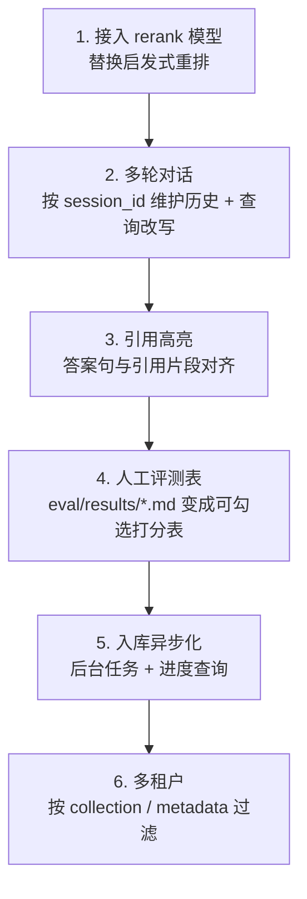

# 待补充与路线图

## 需要你补充的清单（`[待补充]` 汇总）

| # | 位置 | 需要补充的内容 |
| --- | --- | --- |
| 1 | `.env` | `LLM_API_KEY`、`LLM_BASE_URL`（如需改）、`LLM_MODEL`（如需改） |
| 2 | `.env` | 若用 `EMBEDDING_PROVIDER=api`，还需 `EMBEDDING_API_KEY`、`EMBEDDING_BASE_URL`、`EMBEDDING_MODEL`、`EMBEDDING_DIM` |
| 3 | `.env` | 若用 `EMBEDDING_PROVIDER=local`，需 `LOCAL_EMBEDDING_MODEL` |
| 4 | `data/documents/` | 替换为你真实的汽车售后知识库文档（删除自带的占位示例） |
| 5 | `eval/eval_set.json` | 20 条样本的 `ground_truth`、`expected_sources`、`expected_keywords` |
| 6 | `.env` | 如有需要：`API_KEY`、`CORS_ORIGINS`、`CHROMA_COLLECTION` |

---

## 下一步可做的扩展（按性价比排序）

### 1. 接入 rerank 模型（第一优先级）

用 `bge-reranker` 之类的 cross-encoder 替换启发式重排。

**为什么排第一**：[实测记录](../evaluation/results.md)里两个未解决的失败样例
（`虚构车型A多久换一次机油`、`车辆失火是什么原因`）说明启发式信号已到极限，
需要语义级重排才能解决。继续调权重就是针对样例过拟合。

### 2. 多轮对话

按 `session_id` 维护历史，并对历史问题做查询改写。

### 3. 引用高亮

在 `console.html` 里把引用片段与答案句做对齐展示。

### 4. 人工评测表

把 `eval/results/*.md` 变成可勾选的人工打分表，明确区分自动指标与人工结论。

### 5. 入库异步化

改成后台任务 + 进度查询，支持大批量文档。

### 6. 多租户

按 `collection` 或 metadata 过滤实现车型/门店隔离。

---

## 还欠着的技术债

除上表外，还有这些在 [LangGraph Agent](../modules/agent.md#尚未解决的局限) 里记录的未收敛问题：

- 工具调用次数靠提示词约束，实测仍会出现重复检索——需要图层面的硬约束；
- `ask_user` 追问措辞质量未做校验。

以及 [设计与已知局限](design.md) 里列出的 7 项结构性限制。
