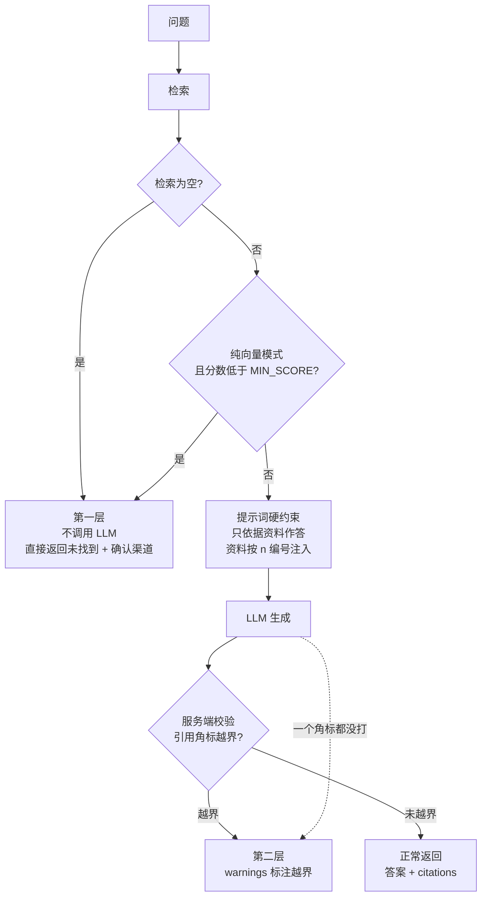

# 引用校验与无依据拒答

对应代码：`app/services/rag_pipeline.py`

这是本项目最想强调的设计：**让"不确定"变得可见，而不是被模型的话术掩盖**。

---

## 三层兜底



| 层 | 机制 | 目的 |
| --- | --- | --- |
| 1 | 检索为空 / 分数低于阈值时**不调用大模型** | 从源头掐掉无依据生成，同时省 token |
| 2 | 提示词硬约束 + 资料按 `[n]` 编号注入 | 让模型有据可依、有据可引 |
| 3 | 服务端校验角标是否越界 | 防止"看起来有引用其实没有" |

---

## 提示词约束

提示词明确要求：

- 只依据给定资料作答；
- 保留版本限定（如"2027 款"这类限定不能丢）；
- 无依据时拒答，并给出确认渠道。

---

## 服务端引用校验

生成完成后，服务端检查答案里的 `[n]` 是否超出实际资料编号范围。

!!! tip "为什么必须做服务端校验"
    模型可能会编出 `[7]`，而这次只检索到 5 条资料。
    这在用户眼里"看起来有引用"，实际是无依据生成。
    响应的 `warnings` 会明确标出这类情况。

---

## 逐句归因校验（比编号校验更进一步）

编号校验有个盲区：**编号合法、格式正确，但那句话的内容根本不在被引用的片段里**。

比如片段只说「机油每 8,000 km 或 8 个月更换」，模型却写成
「机油每 8,000 km 更换，**可延长发动机寿命约 30%** [1]」——
`[1]` 是合法编号，编号校验完全看不出来。

`app/core/attribution.py` 把回答拆成**分句**，逐句检查关键词是否真在被引用的片段里：

| 状态 | 覆盖率 | 含义 |
| --- | --- | --- |
| `supported` | ≥ 0.35 | 有依据 |
| `weak` | 0.12 – 0.35 | 可能是同义改写，建议复核 |
| `unsupported` | < 0.12 | **疑似编造** |
| `no_citation` | — | 整句没有引用角标 |

结果放在响应的 `attribution` 字段，严重时追加 warning。**只报告不拦截** —— 不改回答正文，
因为改正文既破坏可读性，也可能误删正确内容。

!!! warning "为什么必须下沉到分句"
    「机油每 8,000 km 更换 [1]，可延长发动机寿命约 30% [1]」—— 整句算覆盖率时，
    前半段真话会把分数拉高、判成"有依据"。拆成分句后，后半段单独算只有 **0.24** 才抓得住。
    这是分句级校验最核心的价值。

!!! tip "元话语不要求引用"
    「未找到相关依据」「建议以《用户手册》为准」「联系授权服务站」这类话**天然没有出处**。
    实测若不排除它们，拒答场景 16 个校验单元里有 **8 个**是误报。

!!! danger "别过度跳过"
    跳过规则写太宽会让功能静默失效。曾有一版把「参考资料中仅包含…」也跳过，
    结果整个回答被判成 0 个校验单元 —— 看起来"没报错"，实际什么都没查。

---

## `warnings` 会在这些情况出现

服务端**如实报告，不掩盖**：

| 情况 | warning |
| --- | --- |
| 模型给出的 `[n]` 超出实际资料编号范围 | `引用编号越界` |
| 模型一个角标都没打 | 提示可能未遵循引用格式，`citations` 会退化为全部召回来源 |
| 检索为空但 `REFUSE_WHEN_EMPTY=false` | 提示回答可能无依据 |
| `EMBEDDING_PROVIDER=hash` | 提示当前不具备真正的语义检索能力 |

---

## 响应结构

```json
{
  "question": "首保应该在多少公里或多长时间内进行？",
  "answer": "……（每处结论带 [1] 这类角标）……\n\n依据：\n[1] 保养周期.md · 保养 > 首保",
  "citations": [
    {
      "index": 1,
      "chunk_id": "doc_xxxxxxxxxx::3",
      "source": "保养周期.md",
      "title": "保养周期",
      "section": "保养 > 首保",
      "position": 3,
      "score": 0.0,
      "snippet": "……"
    }
  ],
  "refused": false,
  "retrieval_mode": "hybrid",
  "model": "deepseek-chat",
  "latency": { "retrieve_ms": 0, "generate_ms": 0, "total_ms": 0 },
  "usage": { "prompt_tokens": 0, "completion_tokens": 0, "total_tokens": 0 },
  "warnings": []
}
```

关键字段：

- `refused`：本次是否走了兜底（未调用大模型）；
- `latency`：检索 / 生成 / 合计耗时拆解，便于定位慢在哪一环；
- `warnings`：本次是否需要人工留意。

---

!!! warning "流式模式不做越界校验"
    `POST /api/v1/chat/stream` **不做**服务端引用越界校验（回答还在生成中）。
    前端拼接完成后如需校验，请改用 `POST /api/v1/chat`。
    这一点在 `done` 事件里也会明确提示。

---

## 做得比较克制的地方

- **不编造数据**：仓库内所有数值均为 `[待补充]` 占位，示例文档也明确标注不是真实数据；
- **不隐藏降级**：`hash` 模式、LLM 未配置、引用越界都会通过 `/health`、响应 `warnings` 明确暴露；
- **密钥管理**：只从 `.env` / 环境变量读取，日志与接口响应从不回显密钥明文。

更多局限的坦诚说明见 [设计与已知局限](../about/design.md)。
