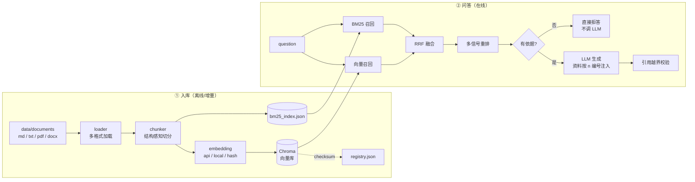

---
sources:
  - app/main.py
  - app/services/container.py
---
# 整体架构与目录结构

## 数据流一览



两条链路是分开的：**入库**只在文档变化时跑，**问答**每次请求都跑。
`/api/v1/retrieve` 只做 `R1 → R4`，不进入 LLM，因此可以零成本单独评估召回质量。

---

## 这个项目有什么（面试可讲的技术点）

| 能力 | 实现方式 | 对应代码 |
| --- | --- | --- |
| 结构感知切分 | 标题层级 + 段落 + 句子三级兜底；**Markdown 表格作为原子块**、超长表按行切并逐片重复表头 | `app/core/chunker.py` |
| 多格式加载 | `.md/.markdown/.txt` 内置；`.pdf/.docx` 走可选依赖，缺失时给出安装提示而不是崩溃 | `app/core/loader.py` |
| 向量库 | Chroma `PersistentClient` 落盘，cosine 距离，**显式传入自己算的向量**（不依赖 Chroma 默认模型下载） | `app/core/vector_store.py` |
| 混合检索 | 向量召回 + 自研 BM25（零依赖、中英文混合分词含中文 bigram）→ RRF 融合 → 四信号重排（融合分/词覆盖/高精度串/整句命中） | `app/core/bm25.py`、`app/core/retriever.py` |
| Embedding 可切换 | `api`（OpenAI 兼容）/ `local`（sentence-transformers）/ `hash`（零依赖，仅验证链路） | `app/core/embedding.py` |
| 带引用回答 | 资料按 `[n]` 编号注入提示词，回答必须带角标；服务端校验角标是否越界 | `app/services/rag_pipeline.py` |
| 无依据兜底 | 检索为空或（纯向量模式下）相似度低于阈值时**不调用大模型**，直接返回确认渠道 | 同上 `should_refuse` |
| 增量入库 | `data/registry.json` 记录 checksum，未变更文件跳过；磁盘删除的文档同步清理 | `app/services/ingestion_service.py` |
| 可观测 | `/health`、`/stats`、每次问答返回 `latency` 拆解（检索/生成/合计）与 token 用量 | `app/api/routes_system.py` |
| 评测闭环 | 20 条评测集模板 + HTTP 接口评测 + 独立脚本，输出 JSON/Markdown 报告 | `eval/eval_set.json`、`scripts/run_eval.py` |
| 交付 | Dockerfile（非 root + healthcheck + tini）、docker-compose.yml、内置零依赖调试控制台 | `Dockerfile`、`app/web/console.html` |

---

## 目录结构

```text
AutoRAG/
├── app/
│   ├── main.py                  # FastAPI 入口：lifespan 装配、路由挂载、GET /api/v1/ask、调试控制台
│   ├── config.py                # .env -> Settings（含占位符检测、路径解析、启动自检）
│   ├── models.py                # Pydantic 数据契约（请求/响应/引用/评测集）
│   ├── logging_conf.py          # 日志统一格式
│   ├── api/
│   │   ├── deps.py              # ServiceContainer 与依赖注入、可选 X-API-Key 校验
│   │   ├── routes_system.py     # /health /stats /sources /version DELETE /collection
│   │   ├── routes_ingest.py     # /ingest /ingest/upload
│   │   ├── routes_qa.py         # /retrieve /chat /chat/stream /chunks/preview
│   │   └── routes_eval.py       # /eval/dataset /eval/run /eval/reports
│   ├── core/
│   │   ├── text_utils.py        # 归一化、分句、中英混合分词、哈希、摘要
│   │   ├── chunker.py           # 三级切分 + 重叠 + 章节路径
│   │   ├── loader.py            # 文档读取（md/txt/pdf/docx）
│   │   ├── embedding.py         # api / local / hash 三种 embedder
│   │   ├── vector_store.py      # Chroma 封装
│   │   ├── bm25.py              # 自研 BM25 + JSON 持久化
│   │   ├── retriever.py         # 向量 + BM25 + RRF 融合 + 重排
│   │   └── llm_client.py        # OpenAI 兼容客户端（同步 + SSE 流式 + 重试）
│   ├── services/
│   │   ├── container.py         # 组件装配（失败降级不崩服务）
│   │   ├── ingestion_service.py # 扫描/增量/删除/BM25 重建
│   │   ├── rag_pipeline.py      # 提示词、引用组装、校验、兜底
│   │   └── eval_service.py      # 评测运行与报告落盘
│   ├── guard/                   # FreshGuard：知识库变更影响分析
│   │   ├── claims.py            # 原子化声明模型（归一化、变更判定、严重度分级）
│   │   ├── extractor.py         # LLM 结构化抽取 + 证据子串校验 + 增量复用
│   │   ├── store.py             # SQLite 声明版本库（doc_version / chunk_hash / claim）
│   │   └── service.py           # 增量抽取编排、跨版本差分、影响面反查
│   ├── agent/                   # LangGraph Agent：自主决定调用哪些工具
│   │   ├── kb.py                # 业务工具数据层（故障码 / 保养周期，SQLite + 表格机械解析）
│   │   ├── tools.py             # 四个工具（search_kb / lookup_dtc / compute_maintenance / ask_user）
│   │   ├── graph.py             # 状态图：agent / tools / finalize 三节点 + 条件路由
│   │   └── service.py           # 服务封装：一次性调用与 SSE 事件流
│   └── web/
│       ├── console.html         # 内置调试页（打开 http://127.0.0.1:8000/ 即用）
│       └── guard.html           # 变更审计面板（打开 http://127.0.0.1:8000/guard）
├── eval/
│   ├── eval_set.json            # 20 条评测集模板（答案位置为 [待补充]）
│   └── results/                 # 评测报告输出目录（自动创建）
├── scripts/
│   ├── preflight.py             # 启动前自检：一条命令定位环境/配置/依赖问题
│   ├── ingest.py                # 命令行入库（调 HTTP 接口，保证三处状态一致）
│   ├── run_eval.py              # 命令行评测（纯标准库，输出 JSON + Markdown）
│   └── publish_check.py         # 作品集发布前检查（密钥/文档侵权风险/运行时产物）
├── data/
│   ├── documents/               # 你的知识库文档放这里
│   ├── chroma/                  # 向量库持久化（自动生成）
│   ├── uploads/                 # 上传文件落地（自动生成）
│   ├── registry.json            # 增量入库记录（自动生成）
│   └── bm25_index.json          # BM25 索引（自动生成）
├── tests/smoke_test.py          # 冒烟测试（无需大模型，验证切分/BM25/融合逻辑）
├── .env.example                 # 环境变量模板（复制为 .env 后填写）
├── requirements.txt             # 核心依赖
├── requirements-local.txt       # 可选：本地向量模型
├── Dockerfile
├── docker-compose.yml
├── LICENSE                      # MIT
├── NOTICE                       # 示例文档的来源与授权说明
└── README.md
```

!!! info "`resume/` 与 `_resume*/` 目录"
    `resume/` 存放求职材料（面试问答、演示脚本），已被 `.gitignore` 排除，**不随公开仓库发布**。

---

## 深挖各个模块

- [结构感知切分](chunking.md) —— 表格为什么必须当原子块
- [混合检索与重排](retrieval.md) —— BM25 + RRF + 四信号重排
- [Embedding 三种模式](embedding.md) —— api / local / hash 的取舍与踩坑
- [引用校验与无依据拒答](citation.md) —— 三层兜底怎么实现
