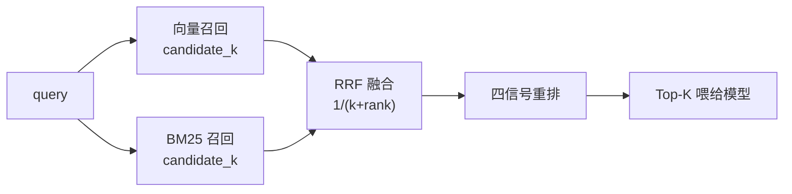

---
sources:
  - app/core/bm25.py
  - app/core/retriever.py
  - app/core/reranker.py
---
# 混合检索与重排

对应代码：`app/core/bm25.py`、`app/core/retriever.py`、`app/core/reranker.py`

这一页是本项目技术密度最高的部分。为什么要自研 BM25？RRF 怎么融合？
四信号重排分别解决什么问题？为什么最后说"再加权重就是过拟合"？

---

## 整体链路



两路召回各自独立，用 RRF（Reciprocal Rank Fusion）按**名次**而非**分数**融合 ——
这一点很关键，因为余弦相似度和 BM25 分数不在同一量纲上。

---

## 一、自研 BM25（`app/core/bm25.py`）

**为什么不用现成库**：为了零依赖、可观测、可讲清每一环。
BM25 索引以 JSON 落盘（`data/bm25_index.json`），进程内加载。

### 中英文混合分词

- 英文按词切分；
- 中文按**单字 + bigram（双字）**同时入索引。

例如「更换机油」→ `更`、`换`、`机`、`油`、`更换`、`换机`、`机油`。

### 虚词降权（`SINGLE_CJK_WEIGHT`）

单字 + bigram 策略有个固有副作用：任意两句中文都可能共享「的 / 是 / 关」这类单字，
于是「P0300 是 什么 意思」里的虚词各自贡献一份 IDF，噪声压过了真正的故障码。

**处理**：单个中文字符按 `SINGLE_CJK_WEIGHT` 降权（bm25 侧 0.3，重排侧 0.25）。

### 相对分数下限（`MIN_RELATIVE_SCORE`）

BM25 对"完全不相关的中文问题"也可能返回结果（单字共现导致）。
代码里加了相对分数下限（默认 `0.15`）。

!!! note "这是分词策略的固有特性，不是 bug"
    想进一步降低噪声，正确的方向是接 rerank 模型，而不是继续调阈值。

### 整串命中加权（`PHRASE_BOOST`）

查询里的 `P0300`、`5w-30` 这种整串出现在片段中，是比"碰巧共享单字"强得多的证据。
`_query_phrases()` 把查询按空格/标点切出词组，整体命中时加权（默认 `1.3`）。

---

## 二、RRF 融合（`_fuse()`）

融合公式按名次计算：

```text
score = weight / (rrf_k + rank)
```

| 参数 | 默认值 | 说明 |
| --- | --- | --- |
| `RRF_K` | `60` | 融合常数，越大各名次差距越平缓 |
| `VECTOR_WEIGHT` | `1.0` | 向量通道权重 |
| `KEYWORD_WEIGHT` | `0.8` | BM25 通道权重 |

!!! danger "这里踩过一个隐蔽的 bug"
    `_fuse()` 的命名写的是"归一化名次分"，但 **vector 分支漏了归一化**：
    余弦相似度（0.45 量级）直接压过了名次分（0.016 量级），
    导致"BM25 与向量通道都排第 1 的正确答案，融合后掉到第 5"。

    **修复**：向量分支同样按本轮最高分归一化后，再除以 `rrf_k + rank`。

    这个 bug 的教训是：**命名和实现不一致时，先信实现**。

---

## 三、四信号重排

融合后的 top 结果再按四个信号重排：

| 信号 | 解决什么问题 | 说明 |
| --- | --- | --- |
| RRF 融合分 | 基础排序 | 上游结果 |
| 查询词覆盖率 | 长查询的部分匹配 | 用**加权** token 集合，单字降权 0.25 |
| 高精度 token | 故障码、型号、规格 | 含数字/字母的短词（`P0420`、`5w`、`obd2`）命中即加权 |
| 章节命中 | 标题关键词没被利用 | 章节路径命中给 `0.08` 权重 |

### 为什么覆盖率要"加权"

早期版本用**未加权**的 token 集合算覆盖率，结果是：
问「车辆失火是什么原因」，保修条款片段因为含「车/辆/失/火/原/因」这些单字而拿到满分，
真正写着"点火或气缸失火"的故障码表反而召不到。

---

## 四、为什么停止调权重

[第三轮实测](../evaluation/results.md) 后，有两个失败样例**没有解决**，且明确判断
"启发式信号已经到极限"：

| 查询 | 期望命中 | 实际第 1 名 | 原因 |
| --- | --- | --- | --- |
| `虚构车型A多久换一次机油` | 示例车型 A 保养时间表 | `README 索引.md` | 索引文档同时提到"机油"和"虚构车型A"，启发式无法区分"目录摘要"与"正文答案" |
| `车辆失火是什么原因` | OBD-II 码表的 P0300 条目 | `保修条款：汽车三包规定全文.md` | "车辆"是"车辆失火"的高频搭配词，BM25 侧分数仍高于真正含"失火"的片段 |

**结论**：这两例需要的是**语义级重排**（cross-encoder / bge-reranker），
而不是继续加权重——再加下去就是针对样例过拟合。

这也是 [路线图](../about/roadmap.md) 把「接入 rerank 模型」列为第一优先级改动的原因。

!!! tip "排序失误 ≠ 问答失败"
    若把 `TOP_K` 从 5 提到 8，「车辆失火」这类问题在生成侧就已经能答对（正确答案在前 3）。
    检索排序指标和端到端问答效果需要分开看。

---

## 五、语义精排（cross-encoder）

启发式的天花板就在这里 —— 需要真正能理解语义的模型来接。

`app/core/reranker.py` 把 `(query, passage)` **一起**送进 cross-encoder 打分，
让"这段话是否真的回答了问题"由模型判断，而不是数关键词。

| 参数 | 默认 | 说明 |
| --- | --- | --- |
| `RERANK_ENABLED` | `false` | 需先下载模型权重 |
| `RERANK_MODEL` | `BAAI/bge-reranker-base` | **中文务必换 `bge-reranker-v2-m3`** |
| `RERANK_TOP_N` | `20` | 只精排前 N 个候选（不能小于 `TOP_K`）|
| `RERANK_MAX_LENGTH` | `512` | 直接决定 CPU 耗时 |

**实测效果**（同一组 6 条查询）：

| 查询 | 无精排 | 有精排 |
| --- | --- | --- |
| 车辆失火是什么原因 | 第 3 名 | **第 1 名** |
| P0420 催化器效率低 | 第 2 名 | **第 1 名** |
| 第 1 名命中率 | 4/6 | **5/6** |

**代价**：CPU 上检索从 22ms 变成约 3.7 秒（8 候选 × 384 token）。

!!! warning "选模型别只看名字：base 版几乎没用"
    `bge-reranker-base`（110M）在这个中文数据集上，「正确片段 vs 干扰项」只差
    **0.228 logit** —— 排序基本是噪声，接入后反而把「车辆失火」从第 3 名**打到第 6 名**。
    换 `bge-reranker-v2-m3` 后区分度 **6.103**（提升 27 倍），才真正生效。
    **模型大小不是关键，区分度才是。**

!!! danger "一个极易误判的坑：双重 sigmoid"
    `sentence-transformers` 的 `CrossEncoder.predict()` 对 `num_labels=1` 的模型
    **已经套过 sigmoid**。调用方再做一次，0.475 / 0.013 会被压成 0.617 / 0.503，
    表现是"精排后排名完全不变"，很容易误判成"模型不行"。
    本项目直接用 `transformers` 取原始 logit，行为完全可控。

!!! note "失败自动降级"
    模型加载或推理失败时，`retrieve()` 记日志并退回启发式顺序 ——
    精排是增强项，不该成为新的故障点。

---

## 检索模式

`RETRIEVAL_MODE` 支持三种：

| 模式 | 行为 |
| --- | --- |
| `hybrid` | 向量 + BM25 + RRF + 重排（默认，推荐） |
| `vector` | 仅向量召回，`MIN_SCORE` 阈值拒答在此模式下生效 |
| `keyword` | 仅 BM25 |

调试检索**不消耗 token**：

```bash
curl -X POST http://127.0.0.1:8000/api/v1/retrieve ^
  -H "Content-Type: application/json" ^
  -d "{\"query\":\"虚构车型A多久换一次机油\"}"
```

返回结果里同时带 `vector_score` 与 `keyword_score`，可以看到两路各自的表现。
