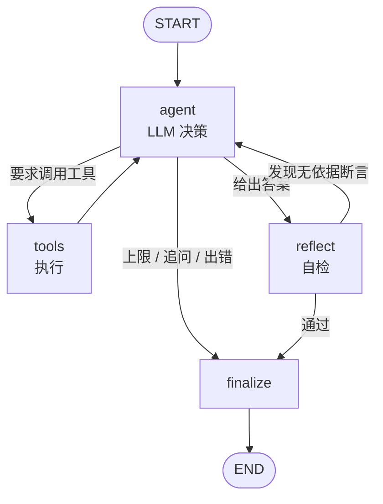

---
sources:
  - app/agent/graph.py
  - app/agent/tools.py
  - app/agent/kb.py
  - app/agent/service.py
  - app/api/routes_agent.py
---
# LangGraph Agent：从固定 pipeline 升级为自主调用工具

对应代码：`app/agent/`

前 13 节描述的是**固定流水线**：问题进来 → 检索 → 生成。它的问题在于流程写死了，
不管问题难易都走同样的路。

本模块把它升级为 **Agent**：由大模型在循环里自主决定调哪个工具、调几次、是否需要先追问用户。

---

## 状态图结构

显式状态图（`StateGraph` + 三个节点 + 一条条件边），**不使用 LangChain 的链式抽象**：



**状态字段**：`messages`（对话历史，用 `add_messages` reducer 自动累积）、
`retrieved_docs`、`current_tool_calls`、`final_answer`、`iteration_count`，
以及为可观测性额外增加的 `tool_trace`、`citations`、`needs_user_input`、`stop_reason`。

### 三道停止条件

满足任一即收尾，避免无效消耗：

| 条件 | 行为 |
| --- | --- |
| 模型不再请求工具调用 | 直接进入 finalize，输出最终答案 |
| `iteration_count` 达到 6 | 强制收尾，如实告知用户"已到上限"，并附上已获得的结果摘要 |
| 模型调用 `ask_user` | 进入 finalize，把问题交回用户；**同一 session 的上下文通过 checkpoint 保留**，用户补充后自动继续 |

---

### 自检节点（reflect）

Agent 给出答案后先不急着收尾，过一个 `reflect` 节点自检：**逐句检查结论是否真被检索片段支撑**。

| 判定 | 行为 |
| --- | --- |
| 出现 `unsupported`（疑似无依据）或整体得分过低 | 清空答案，带上修正要求回到 `agent` 重答 |
| 通过 | 进入 `finalize` |
| 重答额度用尽 | 放行，但把归因报告带进响应（不假装没问题）|

重答额度由 `AGENT_MAX_REFLECTIONS` 控制，默认 **1** 轮 —— 重答本身有成本，多数问题一次修正就够。

!!! note "为什么不让 LLM 自评"
    再调一次模型问"你答得对吗"，会引入第二个不确定性源，而且说不出"凭什么是它不合格"。
    这里复用第 3 梯队的逐句归因校验：确定性、每句都能给出覆盖率、人能复核、
    **不增加任何 token 成本**。

!!! warning "Agent 场景必须用 match_any"
    Agent 可能多次调用 `search_kb`，每次返回的片段编号都从 1 重新开始 ——
    `[2]` 到底指向哪一批的第 2 条无法确定。按编号对齐会张冠李戴，
    所以自检时忽略编号，退化为"在**全量**已检索片段里找依据"。

!!! tip "实测：它真的改变了结果"
    问「P0300 故障码是什么意思」，首次作答归因得分 **0.52**（3 处无依据），
    触发自检重答后升到 **0.944**，iterations 从 2 变成 4。
    而「虚构车型A多久换一次机油」（正常）和「我该保养了吗」（追问场景）
    都不会触发重答 —— 说明没有乱开枪。

---

## 四个工具

工具描述刻意写清「适用 / 不适用 / 边界 / 返回」，因为这是模型能否正确选工具的唯一依据。

| 工具 | 作用 | 数据来源 | 边界（写进了 schema） |
| --- | --- | --- | --- |
| `search_kb` | 知识库混合检索（向量 + BM25 + RRF + 重排），返回带来源的原文片段 | 现有检索链路（**一行检索逻辑都没重写**） | 检索为空时必须如实说未找到，禁止编造库里没有的参数 |
| `lookup_dtc` | 故障码精确查询 / 按症状词模糊搜索 | SQLite（从示例码表机械解析建库，251 条） | 未命中时提示改用 keyword 或 search_kb；不要把范围码当具体码解释 |
| `compute_maintenance` | 按里程与车型算现在该做哪些保养 | SQLite（示例保养周期表，9 项） | 缺车型或里程必须调 `ask_user`；车型不支持时如实告知，禁止套用其它车型 |
| `ask_user` | 追问缺失信息（虚拟工具，无副作用） | — | 信息已足够时禁止调用；一次最多 3 个问题 |

---

## 接口与调用

```bash
# 一次性返回（含完整 tool_trace）
curl -X POST http://127.0.0.1:8000/api/v1/agent/chat \
  -H "Content-Type: application/json" \
  -d '{"session_id":"demo","message":"P0195 故障码什么意思"}'

# SSE 流式：能看到 agent 决策与每个工具的入参出参
curl -N -X POST http://127.0.0.1:8000/api/v1/agent/chat/stream \
  -H "Content-Type: application/json" \
  -d '{"session_id":"demo","message":"我该保养了吗"}'
```

SSE 事件序列（真实抓取）：

```text
start -> node(agent 决定调工具) -> tool_start -> tool_result
      -> node(agent) -> node(tools) -> ... -> answer -> done
```

---

## 本地起服务

```bash
# 1) 装依赖（Agent 依赖 langgraph 与 aiosqlite，已在 requirements.txt 里）
pip install -r requirements.txt

# 2) 业务工具知识库会在启动时自动建立（从 data/documents 下的示例码表与保养表机械解析）
#    想手动重建： POST /api/v1/agent/kb/rebuild?force=true

# 3) 起服务
uvicorn app.main:app --host 127.0.0.1 --port 8000
# 容器方式： docker compose up --build
```

```bash
# 4) 验证
curl http://127.0.0.1:8000/api/v1/agent/status   # 工具列表、业务库规模、迭代上限
curl http://127.0.0.1:8000/api/v1/agent/tools    # 四个工具的完整 JSON schema
```

---

## 实测记录（本机真实执行，未使用编造数据）

| 场景 | 实测行为 |
| --- | --- |
| 纯知识问题：`虚构车型A多久换一次机油？空气滤清器呢？` | 调用 `search_kb` 后直接作答，迭代 2 次，答案带 `[n]` 角标与来源（实测该问题模型会并行发起 2 个检索查询） |
| 故障码问题：`P0195 故障码什么意思` | `lookup_dtc -> search_kb` 两步，迭代 2 次，引用 6–7 条；库中没有检修步骤时**如实说明没有** |
| 故障码问题：`P0300 故障码什么意思？` | 同样 `lookup_dtc -> search_kb`，引用 7 条 |
| 信息不足：`我该保养了吗` | 先调 `ask_user`，追问车型 / 里程 / 使用月数，`stop_reason=ask_user` |
| 补充信息后（同 session） | checkpoint 续接，调 `compute_maintenance` 得出 5 项到期保养，并标注数据为示例 |
| 保养 + 解释联合提问：`16000 公里该做哪些保养？机油更换有什么注意事项？` | `compute_maintenance -> search_kb` 两步，引用 6 条 |
| SSE 流式 | 事件序列含 `tool_start` / `tool_result`，可看到每步入参出参与耗时 |
| 迭代上限 | 脚本化测试中模型连续 20 轮要求调用工具，图在第 6 轮停止并给出摘要 |
| 工具报错 | `lookup_dtc(P9999)` 未命中后，模型改用 `keyword` 参数重试成功（未崩溃） |

**测试规模**：原有 `tests/smoke_test.py` **75 项**（含新增的 Agent schema 不变量）+
新增 `tests/agent_smoke_test.py` **86 项**（覆盖工具链、追问、上限、错误恢复、JSON 容错）。

---

## 已修复的实现缺陷

都是跑起来才发现的，记录在此避免重复踩：

1. **同步 checkpoint 在异步图里不可用**
   LangGraph 的异步图会直接抛 `NotImplementedError: The SqliteSaver does not support async methods`。
   必须改用 `AsyncSqliteSaver`（并装 `aiosqlite`），且它的初始化是异步的，
   因此只能在第一次请求的事件循环里延迟建好。

2. **`tool_call_id` 丢失导致 422**
   `add_messages` 会把普通 dict 自动转成 LangChain 的 `AIMessage` / `ToolMessage`，
   转换回 OpenAI 格式时若漏掉 `tool_call_id`，
   DeepSeek 会报 `messages[i]: missing field 'tool_call_id'`。

3. **节点里 `yield` 的事件会被丢弃**
   LangGraph 把节点产出当作状态增量，非状态字段直接忽略（实测 `tool_start` 全部丢失）。
   正确做法是 `StreamWriter` + `stream_mode=["updates","custom"]`。

---

## 尚未解决的局限

- **工具选择依赖模型判断**，实测同一问题可能出现"多查一次"的情况（如两次 `search_kb`），
  结果正确但调用次数不是最优；如果要做成本优化，需要引入更严格的路由提示词或小模型分类器。
- **已尝试但未完全解决的收敛问题**：知识型问题上，模型有时会在同一轮并行发起 2 个 `search_kb`
  （换近义词重复检索）。已在系统提示词里加入「收敛原则」（明确要求上一次检索能回答就不要再检索），
  但实测仍会出现——说明**提示词对工具调用次数的约束力有限**。
  真要控成本得在图层面加约束（例如：同一节点内同名工具只允许调用一次，
  或对第二次调用做去重合并），这是比调提示词更可靠的下一步。
- **`ask_user` 的追问措辞由模型生成**，偶发问得过于宽泛（例如同时问三项），
  目前只靠 schema 的 `maxItems=3` 约束，没有做措辞质量校验。
- **业务工具知识库来自示例数据**（虚构车型 A + 自编码表），
  代码结构留好了 SQLite 接口，但要接真实车型数据仍需替换数据源。

---

## AI 辅助开发边界

**由人设计**：状态图结构、工具 schema 描述、停止条件与容错策略。

**有 AI 辅助生成**：示例码表解析、正则与样板代码。

**全部逻辑经人工复核**，并由 86 项确定性测试覆盖。
