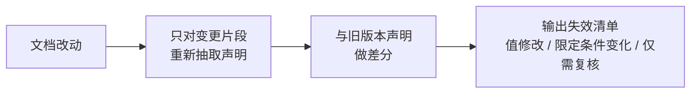

---
sources:
  - app/guard/claims.py
  - app/guard/extractor.py
  - app/guard/service.py
  - app/guard/store.py
  - app/api/routes_guard.py
---
# FreshGuard：知识库变更影响分析

对应代码：`app/guard/`

RAG 只能回答「**语义最相近**的是哪一块」；它回答不了另一个同样关键的问题：

> **这份文档改了之后，以前答过的内容里哪几句已经失效了？**

FreshGuard 就是在片段之上再加一层「原子化声明」，让"答案是否还有效"变成一次结构化比对。

---

## 核心链路

---

## 核心设计

| 环节 | 做法 | 为什么这么做 |
| --- | --- | --- |
| **声明抽取** | 用 LLM 把散文抽成 `主体｜属性｜值｜限定条件`，并要求给出**原文证据** | 只做向量相似度无法判断"数值是否变了" |
| **证据校验** | 服务端强制校验 `evidence` 必须是片段原文的**连续子串**，不通过就丢弃 | 防止模型"顺手补常识"，保证每条声明都能人工核对 |
| **增量抽取** | 按片段内容哈希判断：没变就复用历史声明，不重复调 LLM | 87 个片段改 2 行，只需要 1 次 LLM 调用 |
| **版本管理** | SQLite 按 `doc_version` 归档声明快照，永久保留历史 | 向量库只存"当前状态"，做不了版本对比 |
| **差分分级** | 值修改 / 限定条件变化 / 仅需复核 三级 | 见下方"踩过的坑"，分级是为了让清单可用 |

---

## 本机实测数据

| 项目 | 实测结果 |
| --- | --- |
| 首次全量抽取 | 6 份文档、87 个片段 → **763 条声明**，81 次 LLM 调用，171 秒 |
| 解析与证据校验 | 解析失败 **0** 次，无依据丢弃 **0** 条（通过率 100%） |
| 增量抽取 | 改动保养周期 2 行后：**只重抽 1 个片段**（1 次 LLM 调用），复用 6 个片段 → 调用量降至 1/7 |
| 差分结果 | 值修改 2 条（high）· 限定条件变化 1 条 · LLM 抖动误报 2 条（被降级为 recheck） |
| 跨文档影响面 | 反查「机油」命中保养周期表 3 条 + 故障码表 P0195/P0520/P0521 共 6 条 |

!!! warning "这不是性能基准"
    以上为开发机单机单次实测，会随机器、文档规模、模型而变。

**复现方式**：面板可视化 `http://127.0.0.1:8000/guard`；接口见 [接口一览](../api/reference.md)。

---

## 踩过的坑（这段最有面试价值）

### 大模型抽取粒度不稳定，"值没变"却报出修改，把真实变更淹没了

- **现象**：改动机油周期后，差分列出 3 条 high 严重度，其中一条是「更换发动机冷却液」，
  但它的**旧值和新值完全一样**。
- **定位**：把两个版本的声明逐字段打出来对比，发现这条声明的 `qualifiers`
  从一个「首次」变成了空数组——值没变，是**限定条件**的识别不稳定。
- **修复**：把变更从二分类改成三分类，`qualifier_changed` 单独统计并降级为 medium，
  这样 high 里剩下的就都是真正的数值变更。

### 第二个同类问题

- 还有一条声明被报成 `removed`（值被删了），但它的 `evidence` 原文**仍然在文档里**，
  说明只是这次抽取没抽出来，不是知识被删除。
- **修复**：加一层证据复核——若"被删除"的声明其证据仍能在当前正文中找到，
  就降级为 `recheck` 并标注原因。

!!! success "结论"
    只要在 LLM 抽取之上叠一层"**证据可核对 + 变更分级**"，
    就能把不确定的模型输出约束成**可用的审核清单**。
    这也是"AI 辅助开发"里人工把关应该放在哪一层的具体答案。
