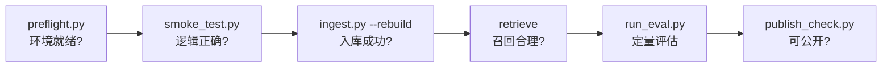

---
sources:
  - tests/smoke_test.py
  - tests/agent_smoke_test.py
  - scripts/preflight.py
---
# 测试与自检

项目提供两层自动化验证：**纯逻辑冒烟测试**（不联网、不需要 Key）和**环境自检脚本**。

---

## 冒烟测试

```bash
python tests/smoke_test.py        # 30 项纯逻辑断言，不联网、不需要 Key、不调用大模型
python tests/agent_smoke_test.py  # Agent 专项（79 项）
python scripts/preflight.py       # 环境与配置自检
```

### `tests/smoke_test.py` 覆盖范围

| 模块 | 断言内容 |
| --- | --- |
| 文本处理 | 文本归一化 / 分句 / 中英混合分词 |
| 切分 | "多章节产出多片段 + 可复现 + 内容不丢失 + 表格不被切断" |
| BM25 | 中文召回、词典外查询返回空 |
| 融合 | RRF 融合的双路标记与排序 |
| 引用 | 引用越界校验 |
| Embedding | hash embedder 的维度与可复现性 |

### `tests/agent_smoke_test.py`（79 项）

覆盖工具链、追问、迭代上限、错误恢复、JSON 容错。

!!! note "测试规模会随迭代增长"
    Agent 模块上线后，原 `tests/smoke_test.py` 扩展为 **68 项**
    （含新增的 Agent schema 不变量），并新增独立的 `tests/agent_smoke_test.py` **79 项**。

---

## 环境自检

```bash
python scripts/preflight.py            # 不调用 LLM，零 token 消耗
python scripts/preflight.py --ping-llm # 额外真实探测一次 LLM，约 1 token
```

完整检查项见 [排查手册](troubleshooting.md#先跑一次自检最省时间的一步)。

---

## 评测脚本

```bash
python scripts/run_eval.py              # 完整问答评测（消耗 token）
python scripts/run_eval.py --mode retrieve  # 只测召回，零 token
python scripts/run_eval.py --limit 5    # 只跑前 5 条
```

详见 [评测集与评测方式](../evaluation/evaluation.md)。

---

## 发布前检查

如果要把项目公开（GitHub、作品集），先跑：

```bash
python scripts/publish_check.py
```

它检查三类风险：

- **密钥泄露**（是否有密钥被写进会被提交的文件）；
- **文档侵权风险**（`data/documents/` 下的文档是否适合公开）；
- **运行时产物**（`data/chroma/`、`data/uploads/` 等是否会被误提交）。

详见 [作为作品集使用](../about/portfolio.md)。

---

## 建议的执行顺序


